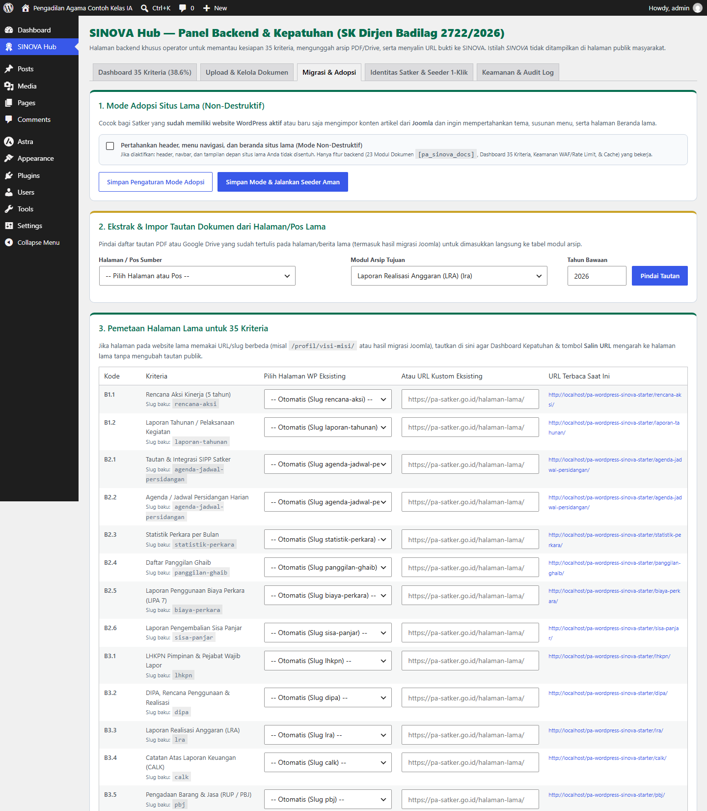

# Starter Kit Website Resmi Pengadilan Agama & Pengelolaan Dokumen Publik (SK Dirjen Badilag 2722/2026)

Paket *starter* **open source** (Lisensi MIT) untuk membantu satuan kerja **Pengadilan Agama** di Indonesia menyiapkan dan menata website resmi berbasis **WordPress** sesuai standar tata kelola informasi **SK Dirjen Badilag Nomor 2722/DJA/SK.TI1/X/2026**.

Seluruh fitur dikemas dalam 6 berkas `mu-plugins` tanpa ketergantungan plugin komersial. Paket ini dapat dipakai pada **website baru**, maupun diterapkan secara aman pada **website WordPress yang sudah berjalan** dan **hasil migrasi dari Joomla** tanpa menghapus berita ataupun arsip lama.

---

## Pratinjau Tampilan

### 1. Beranda Portal (Mode Terang & Akses CCTV ACO)


### 2. Beranda Portal (Mode Gelap / Dark Mode)


### 3. Halaman Arsip Dokumen Publik & Sidebar Navigasi


### 4. Ruang Operator: Dashboard Kepatuhan 35 Kriteria


### 5. Ruang Operator: Alat Migrasi & Adopsi Situs Lama


### 6. Ruang Operator: Keamanan Berlapis & Sembunyikan Login Admin


---

## Ringkasan Kemampuan

1. **Tampilan Publik Bersih, Modern, Formal, WCAG 2.2 & Independen CDN:** Seluruh istilah teknis penilaian hanya muncul di ruang admin operator (**WP Admin → SINOVA Hub**) dan tidak ditampilkan ke masyarakat. Tampilan mengusung header 2 baris *full-bleed* yang elegan dengan **6 Menu Utama Standar** (*Beranda*, *Profil Pengadilan*, *Layanan Hukum*, *Transparansi*, *Layanan Publik & Pengaduan*, *Berita & Publikasi*) dan **Mega Menu 4-kolom mengambang** (simetris 2/3/4 kolom tanpa ikon berlebih), **Pencarian Terpadu `Ctrl+K`** tunggal (pencarian menu, 23 arsip dokumen, layanan, & pencarian penuh WordPress), pilihan **Palet Aksen Visual** (Royal Gold `#C9A227` atau Oranye Badilag `#ff9900`), keterangan hover-clean & **efek parallax ringan berbasis GPU**, **Mode Terang & Mode Gelap**, jam WIB + **indikator status PTSP**, pita **Informasi Serta-Merta (KMA 2-144/2022)**, **Pratinjau Dokumen PDF/Drive di Halaman (Modal)**, **Meta Description dinamis + JSON-LD (`GovernmentOrganization`, `WebSite`, `NewsArticle`, `BreadcrumbList`) + Open Graph + Twitter Card + Web App Manifest**, font sistem **tanpa ketergantungan Google Fonts CDN eksternal**, **Dock Floating mini Access CCTV Online (ACO)** beraset GIF lokal (`assets/cctv-aco.gif`, dapat diatur/diganti di WP Admin dan ramah `Stop Animasi`), pemisahan **Berita Terkini Satker** dengan **Pengumuman**, kartu **6 Area Zona Integritas dinamis (`[pa_sinova_zi_grid]`)**, tombol kembali ke atas rapi, halaman wajib **KMA 2-144/2022** (`/disabilitas/`, `/informasi-serta-merta/`, `/informasi-tersedia-setiap-saat/`, `/layanan-pengaduan/`, `/zona-integritas/`), serta **Panel Aksesibilitas WCAG 2.2 Paripurna** (pembesar teks, kontras tinggi, mode gelap, spasi disleksia, garis bawah tautan, monokrom, hentikan animasi, & pembaca suara Bahasa Indonesia).
2. **Pengumuman Satker & Umpan RSS Resmi 3 Kolom Sejajar (`[pa_official_announcements]`):** Menampilkan **3 kolom pengumuman sejajar** secara otomatis: **Pengumuman Satker** (kategori WP `pengumuman`, informasi serta-merta, & panggilan ghaib), **Mahkamah Agung RI (RSS)**, dan **Ditjen Badilag MA RI (RSS)** — dilengkapi perlindungan **SSRF-safe** (pembatasan ketat suffix domain `.mahkamahagung.go.id` / `.badilag.net` / `.go.id` serta validasi IP publik di setiap hop redirect) dan pembaruan terjadwal.
3. **Data Operasional Terstruktur, Live Slide Sidang SIPP & Integrasi Read-Only SIPP Opsional:** Mengelola **Jadwal Sidang Harian** (`[pa_jadwal_sidang]`), **Layar Live Slide Jadwal Sidang SIPP di Beranda** (`[pa_sinova_sipp_slide]` — cukup tempel URL `Slide_sidang` HTTPS pada **Pengaturan Satker**, otomatis tampil di Beranda dan otomatis diizinkan oleh CSP `frame-src`), **Direktori Hakim & Pegawai** (`[pa_pegawai_grid]`), **Panggilan Ghaib Pasal 27** (`[pa_panggilan_ghaib]`), serta **Statistik Perkara Bulanan** (`[pa_statistik_perkara]`) melalui tabel database terstruktur lengkap dengan filter ARIA aksesibel di frontend serta dukungan opsional pembacaan *read-only* langsung dari database SIPP (`PA_SIPP_DB_*`).
4. **Dashboard 3 Pilar SINOVA + Standar Web Modern Chrome & Ekspor Bukti:** Menghitung otomatis skor berbobot **3 Pilar** (*60% Kualitas & Kepatuhan Konten Wajib 35 Kriteria + KMA 2-144*, *20% Desain UI/UX 2-Click Rule & WCAG 2.2*, *20% Performa, Keamanan & Standar Chrome*) beserta predikat (**Sangat Baik / Excellent** &ge; 90), menyediakan tombol **Ekspor Bukti CSV** dan **Laporan JSON 3 Pilar**, tombol **Salin URL**, pemetaan URL lama, dan pembagian **3 peran operator RBAC** (`pa_kepaniteraan`, `pa_kesekretariatan`, `pa_humas`).
5. **Dukungan Migrasi & Adopsi Situs Lama (Non-Destruktif):**
   * **Mode Adopsi Situs Lama:** Memasang mesin arsip dokumen, keamanan WAF, cache halaman, dan pemantauan 35 kriteria tanpa menimpa header, menu, ataupun Beranda website WordPress yang sudah aktif (otomatis menyesuaikan mode CSP ke `compat`).
   * **Alat Pindai & Impor Tautan:** Membaca tautan Google Drive/PDF dari halaman lama WordPress maupun artikel hasil impor Joomla ke dalam arsip terstruktur.
6. **Pengamanan Chrome Modern Web & Autentikasi Dua Faktor (MFA TOTP Bawaan):**
   * **Chrome Modern Security Headers (Berjalan juga pada Early Cache):** `Content-Security-Policy` per-request **Nonce + `'strict-dynamic'` + `require-trusted-types-for 'script'`** (Trusted Types aman tanpa `innerHTML` di frontend), `Cross-Origin-Opener-Policy: same-origin`, `Cross-Origin-Resource-Policy: same-origin`, `Strict-Transport-Security` (**HSTS Preload 2 Tahun** saat HTTPS), `X-Frame-Options`, `X-Content-Type-Options`, `Referrer-Policy`, `Permissions-Policy`, serta endpoint **`/.well-known/security.txt`** (RFC 9116).
   * **MFA TOTP RFC 6238 Bawaan + 8 Kode Cadangan:** Menghasilkan kode QR **SVG lokal** (rahasia TOTP tidak pernah dikirim ke layanan QR pihak ketiga), perlindungan anti-replay OTP, opsi pengingat wajib MFA, dan flag darurat `PA_DISABLE_CUSTOM_MFA`.
   * **Sembunyikan Halaman Login Admin & Session Hardening:** Memindahkan halaman masuk ke slug khusus satker dengan respon `404 Not Found` pada `/wp-login.php` dan `/wp-admin/` anonim, pembatasan sesi diam admin otomatis **60 menit**, serta kebijakan kata sandi operator minimal **10 karakter** campuran huruf kecil, huruf besar, angka, dan simbol.
   * **Performa Core Web Vitals & Proteksi Aktif:** Cache HTML statis (SWR + **ETag/304** + **Gzip** + `Speculation Rules` + penghapusan bloat WP Emoji/Dashicons/layout thrashing), **File Integrity Monitor (SHA-256)**, penghitung kunjungan aman privasi (hash IP anonim harian), pembatasan login gagal & REST API publik (*Rate Limiter*), proteksi `.htaccess` unggahan PDF + validasi MIME `finfo`, blokir XML-RPC/komentar/enumerasi pengguna, WAF URI/DB, serta anti-bot (**Cloudflare Turnstile** atau soal matematika HMAC offline + honeypot).

---

## Struktur Berkas

```text
sinova-starter-kit/
├── README.md
├── LICENSE
├── .gitignore
├── .htaccess.hardened.example             # Contoh aturan hardening Apache, gzip, & browser caching
├── wordpress-mu-plugins/                  # Salin semua 6 berkas PHP + folder assets/ ke wp-content/mu-plugins/
│   ├── 00-pa-sinova-config.php            # Konfigurasi satker, Security Headers/CSP helper, Seeder, FIM, & Audit 3 Pilar
│   ├── pa-sinova-hub.php                  # Mesin 23 modul dokumen, kartu ZI [pa_sinova_zi_grid], modal pratinjau, & REST HMAC
│   ├── pa-official-feeds-and-data.php     # Pengumuman Satker + RSS MA RI & Badilag 3 kolom (SSRF-safe), data operasional, & SEO JSON-LD
│   ├── pa-home-page-cache.php             # Cache HTML Early-Serve + CSP Nonce + ETag/304 + Gzip + [waktu_render]
│   ├── pa-ui-performance-a11y.php         # Header/Mega Menu 4 kolom, WCAG 2.2 Paripurna, Dock ACO mini, & Pencarian Terpadu Ctrl+K
│   ├── pa-security-hardening.php          # MFA TOTP RFC 6238, security.txt, manifest, password kuat+simbol, custom login URL, & WAF
│   └── assets/
│       └── cctv-aco.gif                   # Aset GIF lokal Dock Floating Access CCTV Online (ACO) Badilag
├── wordpress-templates/
│   └── beranda-blocks-starter.html        # Kerangka HTML halaman Beranda standar Pengadilan Agama (H1 tunggal + [pa_sinova_zi_grid])
├── docs/
│   └── screenshots/                       # Pratinjau tampilan
└── laravel-sinova-panel/                  # Opsional: integrasi jika kantor memakai aplikasi internal Laravel
```

---

## Skenario A: Pemasangan pada WordPress Baru

Cocok bagi satuan kerja yang membangun portal dari awal di hosting cPanel/DirectAdmin, VPS, maupun Laragon/XAMPP lokal.

### Prasyarat
* WordPress baru terpasang (PHP 8.1+ dan MySQL/MariaDB).
* Pasang dan aktifkan tema gratis **Astra** melalui **WP Admin → Appearance → Themes → Add New → cari "Astra" → Install & Activate**.

### Langkah 1: Pasang Folder `mu-plugins`
1. Buka direktori instalasi WordPress Anda (`public_html/wp-content/` atau folder proyek lokal).
2. Buat folder **`mu-plugins`** jika belum tersedia.
3. Salin seluruh berkas `.php` **beserta folder `assets/`** (`assets/cctv-aco.gif`) dari `wordpress-mu-plugins/` ke dalam `wp-content/mu-plugins/`.
   *(Seluruh berkas `.php` di `mu-plugins` aktif otomatis tanpa perlu tombol Activate.)*

### Langkah 2: Atur Struktur Permalink
1. Buka **WP Admin → Settings (Pengaturan) → Permalinks**.
2. Pilih **Post name** (`/sample-post/`), lalu klik **Save Changes**.

### Langkah 3: Isi Identitas Satker & Jalankan Seeder 1-Klik
1. Buka **WP Admin → SINOVA Hub → tab Identitas Satker & Seeder 1-Klik**.
2. Lengkapi **Nama Satker**, URL logo (opsional), alamat kantor, telepon/WA PTSP, email, jam sidang, sambutan pimpinan, tautan **SIPP**, **URL Slide Jadwal Sidang SIPP** (opsional, contoh `https://sipp.pa-satker.go.id/Slide_sidang` — otomatis menampilkan panel layar sidang elegan di Beranda & langsung terdaftar di CSP `frame-src`), **e-Court**, **Direktori Putusan**, **Survei Pelayanan**, serta **URL CCTV Online (ACO)** (`https://cctv.badilag.net/` atau tautan ruangan PTSP satker), **Logo CCTV ACO** (opsional, bawaan memakai `assets/cctv-aco.gif` lokal), & centang **Dock Floating CCTV ACO**, lalu klik **Simpan Pengaturan**.
3. Klik **"Generate Halaman, Beranda & Menu (1-Klik)"** untuk membuat 23 halaman modul dokumen, 17 halaman profil/wajib bertanda `[LENGKAPI]`, halaman Beranda, statistik pengunjung, 3 artikel awal, serta `Menu Utama` pada Astra.

### Langkah 4: Kelola Dokumen, Edit/Hapus Massal & Lengkapi Halaman Profil
1. **Dokumen Rutin (Bulanan/Triwulanan/Tahunan):** Buka tab **Upload & Kelola Dokumen**, pilih modul dan periode slot (hingga 2028+), unggah PDF (maks. 10 MB) atau tempel tautan Google Drive (*Anyone with the link*), lalu simpan.
2. **Perbaikan & Penghapusan Cepat (Edit + Hapus Massal Checklist):** Gunakan filter **Modul / Tahun / Pencarian** pada daftar 100 dokumen terakhir, klik **Edit** pada baris yang perlu direvisi (tidak perlu menghapus atau mengunggah ulang PDF jika hanya memperbaiki judul/slot), atau centang beberapa baris / **Pilih Semua** lalu klik **Hapus Terpilih** untuk menghapus banyak entri sekaligus. Fitur **Edit** dan **Hapus Massal Checklist** juga tersedia pada tab **Data Operasional & RSS**.
3. **Halaman Profil Statis:** Buka **WP Admin → Pages (Laman)**, sunting halaman yang bertanda `[LENGKAPI: ...]` (*Visi dan Misi*, *Struktur Organisasi*, *Wilayah Yurisdiksi*, *Prosedur Berperkara*, dll.). Pantau kemajuannya di tab **Dashboard 3 Pilar & 35 Kriteria**.
4. **Tautan Zona Integritas Beranda:** Isikan URL folder Google Drive Area I–VI pada **WP Admin → SINOVA Hub → Pengaturan Satker** (atau kosongkan agar otomatis mengarah ke halaman `/zona-integritas/`).

---

## Keamanan Lanjutan: MFA TOTP Bawaan & Sembunyikan Login

1. **Mengaktifkan MFA TOTP (Autentikasi Dua Faktor) Operator:**
   * Buka **WP Admin → SINOVA Hub → tab Keamanan, MFA & Audit**.
   * Klik **Mulai Pengaturan MFA TOTP (Generate QR Lokal)**. Pindai kode QR (dihasilkan lokal dalam format SVG) menggunakan Google Authenticator, Aegis, atau FreeOTP, lalu masukkan kode OTP 6 digit untuk mengaktifkan.
   * Simpan **8 kode cadangan pemulihan** yang ditampilkan satu kali. Pemulihan darurat bila kehilangan perangkat maupun kode cadangan dapat dilakukan lewat `define('PA_DISABLE_CUSTOM_MFA', true);` di `wp-config.php`.

Secara bawaan, starter kit **tidak menampilkan tautan Login Admin** pada topbar publik website agar halaman masuk tidak terekspos secara terbuka. Untuk pengamanan tambahan dari serangan otomatis terhadap `/wp-login.php` maupun `/wp-admin/`, operator dapat memindahkan halaman masuk ke alamat rahasia milik satker:

1. Buka **WP Admin → SINOVA Hub → tab Keamanan, MFA & Audit**.
2. Pada panel **Sembunyikan Halaman Login Admin (Custom Login URL)**, ketikkan slug rahasia (minimal 4 karakter huruf kecil/angka/tanda hubung, misalnya `gerbang-operator-pa`), lalu klik **Simpan Pengaturan URL Login**.
3. **Simpan (bookmark) URL baru tersebut** di peramban operator (misalnya `https://pa-satker.go.id/gerbang-operator-pa/`).
4. Setelah aktif:
   * Seluruh tautan masuk, keluar (*logout*), dan lupa kata sandi WordPress otomatis menggunakan slug rahasia tersebut.
   * Permintaan langsung ke `/wp-login.php`, akses anonim ke `/wp-admin/`, serta pengalihan bawaan WordPress (`/admin`, `/login`) akan mengembalikan halaman **`404 Tidak Ditemukan`** sehingga tidak membocorkan letak halaman login.
   * Rate limiter (5x gagal / 15 menit) dan CAPTCHA (Turnstile / soal matematika offline) tetap aktif pada URL login tersembunyi.
5. **Cara Pemulihan Darurat (jika lupa slug login):**
   * Masuk melalui *File Manager* cPanel, FTP, atau SSH, lalu buka berkas `wp-config.php`.
   * Tambahkan baris berikut tepat di atas komentar `/* That's all, stop editing! */`:
     ```php
     define('PA_DISABLE_CUSTOM_LOGIN', true);
     ```
   * Login melalui `/wp-login.php`, buka kembali tab **Keamanan, MFA & Audit** untuk memperbarui atau mengosongkan slug, lalu hapus baris tersebut dari `wp-config.php`.

---

## Skenario B: Penerapan Aman pada WordPress Lama (Tanpa Kehilangan Data)

Jika satuan kerja sudah memiliki website WordPress berisi berita, galeri, serta tata letak Elementor/Astra yang tidak ingin diubah tampilannya, Anda tetap dapat memakai fitur arsip dokumen, dashboard kepatuhan, dan keamanannya secara aman:

1. **Cadangkan Website Terlebih Dahulu:** Ekspor database melalui phpMyAdmin (`.sql`) dan simpan salinan folder `wp-content/` sebelum menambahkan berkas baru.
2. **Pasang Folder `mu-plugins`:** Salin seluruh 6 berkas `.php` **beserta folder `assets/`** dari `wordpress-mu-plugins/` ke `wp-content/mu-plugins/`.
3. **Aktifkan Mode Adopsi Situs Lama (Wajib sebelum menjalankan Seeder):**
   * Buka **WP Admin → SINOVA Hub → tab Migrasi & Adopsi**.
   * Centang opsi **"Pertahankan header, menu navigasi, dan beranda situs lama (Mode Non-Destruktif)"**, lalu klik **Simpan Mode & Jalankan Seeder Aman**.
   * Dengan mode ini aktif: berita lama tetap utuh, header dan Beranda lama tidak diubah, dan sistem hanya menambahkan halaman modul yang belum ada (bila slug yang sama sudah tersedia—baik di root maupun sebagai sub-halaman—sistem langsung mengenalinya tanpa menduplikasi).
4. **Petakan URL Halaman Lama ke Dashboard 35 Kriteria:**
   * Jika halaman lama memakai alamat berbeda (misalnya `/profil/visi-misi/` atau `/keuangan/laporan-lra/`), pilih halaman tersebut pada kolom **Pemetaan Halaman Lama** di tab **Migrasi & Adopsi**, lalu simpan agar **Dashboard 35 Kriteria** menilai dan menyalin URL yang benar.
5. **Pindahkan atau Gabungkan Arsip Dokumen Lama:**
   * **Cara Bertahap:** Tempelkan shortcode `[pa_sinova_docs slug="lra"]` (atau slug modul lain) di bagian atas konten halaman lama untuk dokumen tahun berjalan ke atas, sehingga tabel arsip lama di bagian bawah tetap tampil apa adanya.
   * **Cara Terstruktur (Impor Otomatis):** Pada tab **Migrasi & Adopsi**, pilih halaman lama di formulir **Ekstrak & Impor Tautan Dokumen**, klik **Pindai Tautan**, periksa hasil deteksi tahun & bulan pada pratinjau, lalu klik **Impor Terpilih** agar seluruh tautan masuk rapi ke database arsip.

---

## Skenario C: Panduan Lengkap Migrasi Joomla ke WordPress (Bebas Kehilangan Data)

Bagi satuan kerja yang ingin beralih dari **Joomla (versi 1.5 s.d. 5.x)** ke WordPress agar **ratusan hingga ribuan arsip berita, foto, dan pengumuman historis bertahun-tahun tetap utuh 100%**, ikuti urutan standar berikut.

> 📖 **Panduan Detail:** Untuk tutorial bergambar langkah demi langkah dan checklist lengkap, baca: **[docs/PANDUAN-MIGRASI-JOOMLA-KE-WORDPRESS.md](docs/PANDUAN-MIGRASI-JOOMLA-KE-WORDPRESS.md)**.

### 1. Tool Resmi yang Digunakan: Plugin `FG Joomla to WordPress`
Gunakan plugin resmi **`FG Joomla to WordPress`** (tersedia gratis di direktori plugin WordPress resmi):
* **Pemasangan:** Buka **WP Admin → Plugins → Add New**, cari `FG Joomla to WordPress`, lalu klik **Install Now** dan **Activate**.
* **Persiapan Database:** Buka berkas `configuration.php` di server Joomla lama untuk melihat `$host`, `$user`, `$password`, `$db`, dan `$dbprefix` (misal: `jos_`).
* **Tips Koneksi Aman (Bebas Blokir Port 3306):** Ekspor database Joomla menjadi berkas `.sql` via phpMyAdmin hosting lama, lalu impor ke database MySQL lokal/server WordPress baru. Masukkan host `localhost` pada form importer agar proses impor tidak terganggu firewall hosting.
* **Jalankan Uji & Impor:** Buka **Tools → Import → Joomla (FG)**, klik **Test the database connection**. Setelah sukses hijau, centang *Posts*, *Categories*, *Import images*, dan *Keep original upload dates*, lalu klik **Import content from Joomla to WordPress**.
* **Perbaiki Tautan Internal:** Klik tombol **Modify internal links** setelah proses selesai, kemudian nonaktifkan & hapus plugin importer tersebut.

### 2. Urutan Langkah Pasang Starter Kit Setelah Migrasi Selesai
Setelah artikel dan foto dari Joomla berhasil masuk ke WordPress:
1. **Atur Permalink WordPress (Wajib):** Buka **Settings → Permalinks**, pilih format **Post name** (`/%postname%/`), lalu klik **Save Changes**.
2. **Salin Berkas Starter Kit:** Salin seluruh 6 berkas `.php` dan folder `assets/` dari `wordpress-mu-plugins/` ke direktori `wp-content/mu-plugins/` di server WordPress Anda.
3. **Buka Ruang Operator:** Masuk ke **WP Admin → SINOVA Hub**.

### 3. Wajib Aktifkan "Mode Adopsi" Sebelum Menjalankan Seeder!
> [!CAUTION]
> **JANGAN LANGSUNG KLIK SEEDER STANDAR!**  
> Menjalankan seeder tanpa Mode Adopsi berisiko mengganti menu navigasi lama atau menimpa tata letak Beranda yang sudah Anda siapkan.

1. Buka **WP Admin → SINOVA Hub → tab Migrasi & Adopsi**.
2. Beri tanda centang pada opsi:  
   ☑ **"Pertahankan header, menu navigasi, dan beranda situs lama (Mode Non-Destruktif)"**
3. Klik tombol **"Simpan Mode & Jalankan Seeder Aman"**.
4. **Manfaat Mode Adopsi:**
   * Seluruh berita dan kategori hasil impor Joomla tetap utuh dan aman.
   * Menu navigasi eksisting serta Beranda tidak diubah.
   * Mode CSP otomatis beralih ke `compat` agar skrip tema lama tidak terblokir.
   * Sistem hanya menambahkan 23 modul dokumen publik (LRA, DIPA, SAKIP, dll.) yang belum ada di belakang layar.
5. **Pindai Tautan Dokumen Lama:** Gunakan formulir **Ekstrak & Impor Tautan Dokumen** di tab yang sama untuk menarik tautan Google Drive / PDF dari dalam artikel berita Joomla lama langsung ke dalam tabel arsip terstruktur SINOVA.

### 4. Matriks Troubleshooting Error Umum (Solusi Cepat)

| Gejala / Error | Penyebab Utama | Solusi Praktis |
|---|---|---|
| **`Could not connect to the Joomla database`** | Port MySQL 3306 remote ditutup firewall cPanel hosting asal. | Ekspor database Joomla ke `.sql`, impor ke phpMyAdmin lokal/server baru, dan gunakan host `localhost` di FG Joomla. |
| **`Maximum execution time exceeded` / 504 Gateway Timeout** | Berita dan foto sangat banyak (ribuan) melampaui batas default PHP (30s). | Naikkan `max_execution_time = 300` dan `memory_limit = 512M` di `php.ini`, lalu klik tombol **Resume import** di FG Joomla. |
| **Gambar Berita Pecah (*Broken Images*)** | Opsi *Import images* lupa dicentang atau server lama memblokir hotlink. | Salin folder `images/` dari server Joomla via FTP/cPanel ke `wp-content/uploads/imported-joomla/`. |
| **Tautan Berita Menjadi Error 404** | Pola URL lama Joomla (`/index.php/berita/...`) berbeda dengan format WordPress (`/%postname%/`). | Pasang plugin gratis **Redirection** dan buat aturan regex: Source `^/index.php/(.*)$` → Target `/$1`. |
| **Layar Putih (*White Screen*) / Error 500** | Versi PHP hosting masih < 8.1, atau folder `assets/` lupa disalin. | Upgrade PHP hosting ke PHP 8.2 atau 8.3, dan pastikan folder `wp-content/mu-plugins/assets/` ikut disalin lengkap. |
| **Menu Hilang Setelah Klik Seeder** | Operator lupa mencentang **Mode Adopsi** sebelum klik seeder. | Masuk ke **Appearance → Menus** untuk memilih kembali menu lama Anda, lalu centang Mode Adopsi di tab **Migrasi & Adopsi**. |

### 5. Pengujian Sebelum Pengalihan Domain (*Cut-Over*)
Periksa seluruh tautan melalui **WP Admin → SINOVA Hub → Dashboard 3 Pilar & 35 Kriteria** (target skor &ge; 90), pastikan sertifikat SSL/HTTPS aktif pada domain resmi `.go.id`, lalu lakukan *pointing* DNS domain utama ke WordPress hasil migrasi.

---

## Opsional: Menghubungkan Aplikasi Internal Berbasis Laravel

Jika satuan kerja memiliki aplikasi manajemen internal terpisah berbasis Laravel + Inertia Vue 3 untuk mengelola unggahan dokumen dari jaringan internal kantor:
1. Salin isi folder `laravel-sinova-panel/` ke proyek Laravel Anda (`app/`, `database/migrations/`, `resources/js/Pages/`, dan `routes/`).
2. Jalankan migrasi tabel:
   ```bash
   php artisan migrate
   ```
3. Tambahkan konfigurasi di `.env` Laravel (samakan `SINOVA_WP_SECRET_KEY` dengan kunci pada **WP Admin → SINOVA Hub**):
   ```env
   SINOVA_WP_BASE_URL=https://domain-satker-anda.go.id
   SINOVA_WP_SECRET_KEY=isi_secret_key_hmac_minimal_32_karakter
   SINOVA_WP_TIMEOUT=30
   ```
4. Jalankan `npm run build`, buka route `/update-website`, lalu lakukan sinkronisasi modul.

---

## Panduan Pembaruan (Upgrade) untuk Website yang Sudah Berjalan

Bila satuan kerja sudah memasang versi sebelumnya dan ingin menerapkan pembaruan ini (misalnya fitur **Edit**, **Hapus Massal Checklist**, pengamanan Chrome Modern Web, & halaman wajib KMA 2-144/2022) **tanpa menghilangkan data yang sudah ada**:

1. **Non-Destruktif (Aman untuk Database):** Cukup unduh/tarik pembaruan dari repositori ini lalu salin & timpa seluruh 6 berkas `.php` **beserta folder `assets/`** dari `wordpress-mu-plugins/` ke folder `wp-content/mu-plugins/` pada server WordPress Anda. Tabel dokumen (`pa_sinova_documents`), tabel data operasional (`pa_portal_records`), berita, halaman, menu, dan pengaturan tidak akan terhapus.
2. **Bersihkan Cache HTML (Bila Aktif):** Hapus berkas `.html` sementara di `wp-content/cache/pa-pages/` (atau klik **Purge / Regenerasi** dari panel cache / simpan ulang pengaturan di WP Admin).
3. **Lengkapi Halaman KMA Baru & Perbarui Baseline FIM (Opsional):**
   * Jalankan kembali **Seeder 1-Klik** (dengan atau tanpa Mode Adopsi) jika halaman baru (`/informasi-serta-merta/`, `/informasi-tersedia-setiap-saat/`, `/layanan-pengaduan/`, `/zona-integritas/`) belum ada — halaman yang sudah terbit dan telah disunting tidak akan ditimpa.
   * Buka tab **Keamanan, MFA & Audit** lalu klik **Perbarui Baseline SHA-256** agar *File Integrity Monitor* mencatat hash versi terbaru sebagai kondisi bersih.

---

## Daftar Periksa Sebelum Publikasi Online
- Pastikan domain resmi **`.go.id`** serta sertifikat **HTTPS/SSL** aktif dan valid di server produksi (lalu aktifkan aturan *Force HTTPS* pada `.htaccess` dari contoh `.htaccess.hardened.example` sehingga **HSTS Preload** aktif otomatis).
- Pastikan **Settings → Reading → Search Engine Visibility** tidak mencentang *Discourage search engines from indexing this site* agar situs terindeks Google dan lolos audit SEO Chrome Lighthouse.
- Wajibkan **Autentikasi Dua Faktor (MFA TOTP)** untuk seluruh akun Administrator/Operator dan sembunyikan URL login admin melalui tab **Keamanan, MFA & Audit**.
- Bila memakai **Cloudflare Turnstile**, isikan *Site Key* dan *Secret Key* pada **WP Admin → SINOVA Hub** (bila dikosongkan, sistem otomatis memakai CAPTCHA hitung matematika offline + honeypot).
- Verifikasi kesiapan skor gabungan **3 Pilar SINOVA + Chrome Standards &ge; 90 (Predikat Sangat Baik / Excellent)** serta ekspor bukti CSV/JSON melalui tab **Dashboard 3 Pilar & 35 Kriteria**.
- Pastikan akses database MariaDB/MySQL hanya mendengarkan koneksi lokal (`bind-address = 127.0.0.1`) dan jadwalkan pencadangan database serta `wp-content/uploads/` secara berkala.
