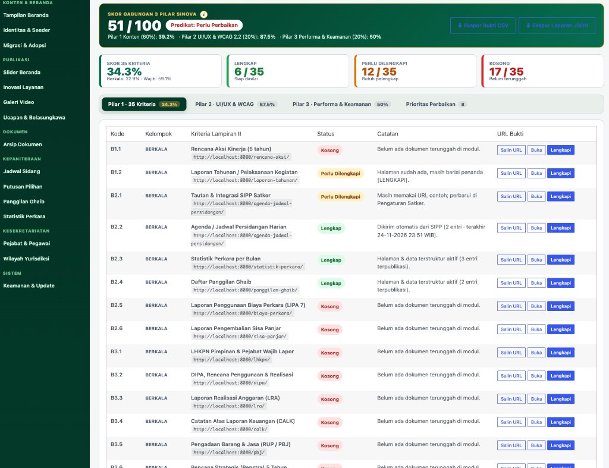

# Starter Kit Website Resmi Pengadilan Agama (SK Dirjen Badilag 2722/2026)

Paket *starter* **gratis & open source** (Lisensi MIT) untuk membangun dan merapikan website resmi **Pengadilan Agama** berbasis **WordPress** sesuai standar **SK Dirjen Badilag 2722/2026** dan **SK KMA 2-144/2022**.

- **Tanpa Elementor & tanpa plugin berbayar** — ringan, cepat, dan ramah operator non-IT.
- **Beranda Dinamis visual (`[pa_sinova_beranda]`)** — atur teks Hero, Ticker, nilai Survei SKM/SPAK/SPKP, dan **Dashboard Jadwal Sidang + Live SIPP** langsung lewat formulir di WP Admin (tanpa sentuh kode HTML).
- **Update 1-Klik dari GitHub** — satker cukup klik satu tombol di WP Admin untuk mendapatkan pembaruan terbaru tanpa kehilangan berita, halaman, atau dokumen.
- **2 Pilihan Pemasangan:** via **Upload Plugin `.zip`** langsung dari WP Admin *(paling mudah, tanpa buka cPanel)* **atau** salin ke folder `wp-content/mu-plugins/`.

---

## Pratinjau Tampilan

| Beranda Mode Terang & CCTV ACO | Beranda Mode Gelap (Dark Mode) |
|---|---|
|  |  |

| Arsip Dokumen Publik (LRA, DIPA, dll.) | Dashboard Kepatuhan 35 Kriteria |
|---|---|
|  |  |

| Migrasi & Adopsi Situs Lama | Keamanan MFA & Sembunyikan Login |
|---|---|
|  |  |

---

## Fitur Utama

1. **Tampilan Publik Modern & Aksesibel (WCAG 2.2):** Header 2 baris + Mega Menu 4 kolom, 6 Menu Utama standar, Pencarian Kilat `Ctrl+K`, Mode Terang/Gelap, Jam WIB + status PTSP, Dock CCTV ACO lokal, Panel Aksesibilitas & Pembaca Suara Bahasa Indonesia, tanpa ketergantungan Google Fonts CDN.
2. **Beranda Dinamis & Dashboard Jadwal Sidang Live SIPP:** Atur seluruh isi Beranda lewat formulir di **WP Admin → SINOVA Hub → Desain & Tata Letak Beranda**. Cukup tempel link `https://sipp.pa-satker.go.id/Slide_sidang` — otomatis tampil dalam tab modern (*Layar Live SIPP* + *Agenda Terstruktur*) dan otomatis diizinkan oleh CSP `frame-src`.
3. **23 Modul Arsip Dokumen & Pengumuman 3 Kolom:** Kelola LRA, DIPA, LKJiP, LIPA 7, Sisa Panjar, LHKPN, Survei, dll. (PDF maks. 10 MB atau tautan Google Drive dengan pratinjau modal), plus pengumuman otomatis 3 kolom (**Satker**, **RSS MA RI**, **RSS Ditjen Badilag**).
4. **Dashboard Audit 3 Pilar & 35 Kriteria:** Menghitung skor kepatuhan otomatis (target **Sangat Baik ≥ 90**) lengkap dengan tombol ekspor **CSV & JSON** dan pembagian peran operator (`pa_kepaniteraan`, `pa_kesekretariatan`, `pa_humas`).
5. **Keamanan Berlapis Bawaan:** CSP Nonce + Trusted Types, **MFA TOTP** (Google Authenticator/Aegis, QR dibuat lokal), **Sembunyikan URL Login Admin** (404 untuk `/wp-login.php`), Rate Limiter, WAF Anti-Judol, CAPTCHA offline / Turnstile, dan *File Integrity Monitor (SHA-256)*.

---

## Cara Pasang Paling Mudah (Upload Plugin `.zip` — Tanpa cPanel)

Cocok untuk **website WordPress baru** maupun **XAMPP lokal** (syarat: **PHP 8.1+**, disarankan 8.2/8.3).

1. **Unduh file plugin siap pakai:**  
   👉 **[Download `pa-sinova-starter.zip`](https://github.com/kang-devlp/pa-wordpress-sinova-starter/raw/main/dist/pa-sinova-starter.zip)**
2. **Pasang tema gratis Astra:**  
   Buka **WP Admin → Appearance → Themes → Add New → cari `Astra` → Install & Activate**.
3. **Upload & aktifkan plugin:**  
   Buka **WP Admin → Plugins → Add New → Upload Plugin → pilih `pa-sinova-starter.zip` → Install Now → Activate**.
4. **Atur Permalink & Jalankan Seeder 1-Klik:**
   - Buka **Settings → Permalinks → pilih `Post name` → Save Changes**.
   - Buka **SINOVA Hub → tab Identitas Satker & Seeder** → isi nama satker, alamat, WA PTSP, tautan SIPP/e-Court/ACO → klik **Simpan Pengaturan**.
   - Klik **`Generate Halaman, Beranda & Menu (1-Klik)`**. Selesai!

---

## Alternatif: Pasang via Folder `mu-plugins` (cPanel / VPS / XAMPP)

Jika lebih suka mode `mu-plugins` (aktif otomatis & *Early Page Cache* berjalan paling awal):
1. Salin **seluruh 6 file `.php` beserta folder `assets/`** dari `wordpress-mu-plugins/` ke folder `wp-content/mu-plugins/`.
2. Aktifkan tema **Astra**, atur Permalink **`Post name`**, lalu jalankan **Seeder 1-Klik** di **WP Admin → SINOVA Hub**.

---

## Cara Atur Beranda & Pasang Jadwal Sidang Live SIPP (Tanpa Edit Kode)

1. Buka **WP Admin → SINOVA Hub → tab Desain & Tata Letak Beranda**.
2. *(Khusus situs upgrade dari versi lama)* Jika muncul peringatan kuning *"Beranda Masih Menggunakan HTML Statis Lama"*, klik tombol **`Aktifkan Beranda Dinamis (1-Klik)`** *(berita, dokumen, dan halaman lain tetap aman)*.
3. Tempel URL Slide Sidang SIPP satker Anda (contoh: `https://sipp.pa-satker.go.id/Slide_sidang`) dan pilih letaknya (*di bawah Hero*, *di bawah 8 Kartu Layanan*, atau *di bawah Sambutan*).
4. Ubah teks Hero, Ticker, nilai Survei SKM/SPAK/SPKP, atau centang bagian yang ingin ditampilkan → klik **`Simpan Desain & Tata Letak Beranda`**.

---

## Cara Update ke Versi Terbaru (Tanpa Kehilangan Data)

### Untuk pengguna v2.2.0 ke atas (Otomatis 1-Klik)
- **Mode Plugin `.zip`:** Klik **"Perbarui sekarang"** di menu **WP Admin → Plugins**, atau lewat **SINOVA Hub → tab Keamanan, Update & Audit → `Update 1-Klik dari GitHub`**.
- **Mode `mu-plugins`:** Buka **SINOVA Hub → tab Keamanan, Update & Audit → klik `Cek Pembaruan Sekarang` → `Update 1-Klik dari GitHub`**. Cache HTML & baseline SHA-256 diperbarui otomatis.

### Untuk pengguna versi lama (v1.0 / v2.0 / v2.1)
1. Cadangkan database (`.sql`) terlebih dahulu.
2. Timpa seluruh isi `wp-content/mu-plugins/` dengan **6 file `.php` + folder `assets/`** terbaru dari `wordpress-mu-plugins/` *(1 kali terakhir — update berikutnya sudah 1-klik dari WP Admin)*.
3. Hapus isi `wp-content/cache/` jika ada.
4. Buka **SINOVA Hub → tab Desain & Tata Letak Beranda → klik `Aktifkan Beranda Dinamis (1-Klik)`**, lalu di tab **Identitas Satker & Seeder** klik **`Rapikan 6 Menu Resmi Sekarang`** *(lewati jika memakai Mode Adopsi situs lama)*.
5. Klik **`Perbarui Baseline SHA-256`** di tab **Keamanan, Update & Audit**.

---

## Memasang di Website Lama / Migrasi dari Joomla (Aman Tanpa Hapus Berita)

- **WordPress Lama (Elementor / desain eksisting):** Setelah pasang plugin/`mu-plugins`, **wajib** buka **SINOVA Hub → tab Migrasi & Adopsi**, centang **"Pertahankan header, menu navigasi, dan beranda situs lama (Mode Non-Destruktif)"**, lalu klik **`Simpan Mode & Jalankan Seeder Aman`**.
- **Migrasi dari Joomla (1.5 s.d. 5.x):** Gunakan plugin gratis **`FG Joomla to WordPress`**, lalu aktifkan **Mode Adopsi** sebelum menjalankan Seeder.  
  📖 Baca panduan lengkap beserta solusi error umum di: **[docs/PANDUAN-MIGRASI-JOOMLA-KE-WORDPRESS.md](docs/PANDUAN-MIGRASI-JOOMLA-KE-WORDPRESS.md)**.

---

## Keamanan Penting & Integrasi Opsional

- **MFA TOTP & Sembunyikan Login Admin:** Aktifkan di **WP Admin → SINOVA Hub → tab Keamanan, Update & Audit**.  
  *Pemulihan darurat bila lupa URL login / kehilangan perangkat MFA:* tambahkan `define('PA_DISABLE_CUSTOM_LOGIN', true);` atau `define('PA_DISABLE_CUSTOM_MFA', true);` di `wp-config.php`.
- **Hardening Apache (`.htaccess`):** Contoh aturan kompresi & keamanan produksi tersedia di [.htaccess.hardened.example](.htaccess.hardened.example).
- **Integrasi Aplikasi Internal Laravel (Opsional):** Folder `laravel-sinova-panel/` menyediakan modul Laravel + Inertia Vue 3 untuk unggah dokumen dari jaringan internal kantor (samakan `SINOVA_WP_SECRET_KEY` di `.env` Laravel dengan Secret Key HMAC di **SINOVA Hub**).
- **Daftar Periksa Sebelum Online:** Pastikan domain `.go.id` sudah memakai **HTTPS/SSL**, **Settings → Reading → Search Engine Visibility** tidak dicentang, dan skor **Dashboard 3 Pilar ≥ 90**.

---

## Struktur Repositori

```text
├── dist/pa-sinova-starter.zip             # Paket plugin WordPress siap upload (1-klik)
├── version.json                           # Manifest versi untuk Update 1-Klik dari GitHub
├── wordpress-mu-plugins/                  # 6 file inti PHP + assets/cctv-aco.gif
├── wordpress-plugin-wrapper/              # Pembungkus plugin standar WP + anti-bentrok
├── wordpress-templates/                   # Referensi template HTML Beranda
├── scripts/build-plugin-zip.sh            # Skrip pembuat ulang dist/pa-sinova-starter.zip
├── docs/                                  # Screenshot & panduan migrasi Joomla
└── laravel-sinova-panel/                  # Opsional: integrasi panel internal Laravel
```
