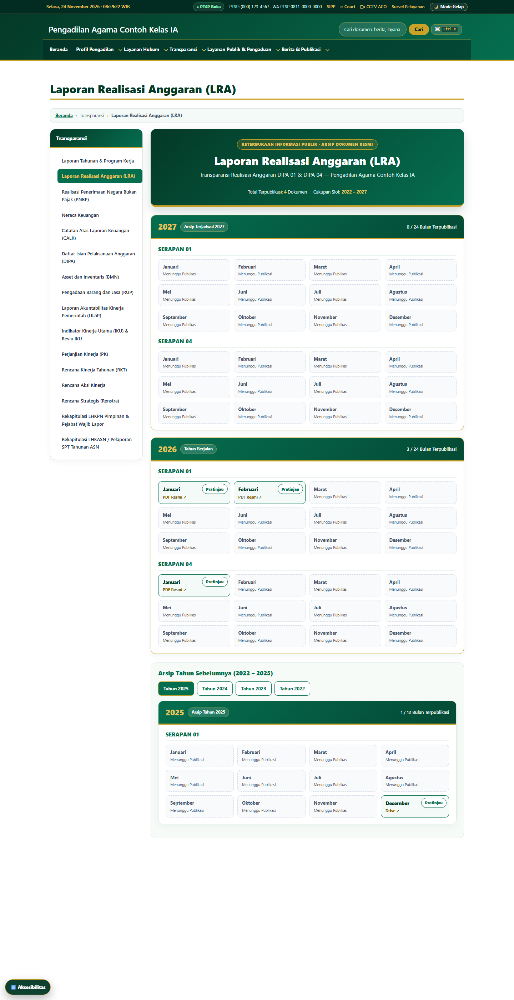

# Starter Kit Website Resmi Pengadilan Agama & Pengelolaan Dokumen Publik (SK Dirjen Badilag 2722/2026)

Paket *starter* **open source** (Lisensi MIT) untuk membantu satuan kerja **Pengadilan Agama** di Indonesia menyiapkan dan menata website resmi berbasis **WordPress** sesuai standar tata kelola informasi **SK Dirjen Badilag Nomor 2722/DJA/SK.TI1/X/2026**.

Seluruh fitur dikemas dalam 6 berkas `mu-plugins` tanpa ketergantungan plugin komersial. Paket ini dapat dipakai pada **website baru**, maupun diterapkan secara aman pada **website WordPress yang sudah berjalan** dan **hasil migrasi dari Joomla** tanpa menghapus berita ataupun arsip lama.

---

## Pratinjau Tampilan

### 1. Beranda Portal (Mode Terang & Akses CCTV ACO)


### 2. Beranda Portal (Mode Gelap / Dark Mode)


### 3. Halaman Arsip Dokumen Publik & Sidebar Navigasi


### 4. Ruang Operator: Dashboard Kepatuhan 35 Kriteria


### 5. Ruang Operator: Alat Migrasi & Adopsi Situs Lama


### 6. Ruang Operator: Keamanan Berlapis & Sembunyikan Login Admin


---

## Ringkasan Kemampuan

1. **Tampilan Publik Bersih, Modern, Formal, WCAG 2.2 & Independen CDN:** Seluruh istilah teknis penilaian hanya muncul di ruang admin operator (**WP Admin → SINOVA Hub**) dan tidak ditampilkan ke masyarakat. Tampilan mengusung **6 Menu Utama Standar** (*Beranda*, *Profil Pengadilan*, *Layanan Hukum*, *Transparansi*, *Layanan Publik & Pengaduan*, *Berita & Publikasi*), pilihan **Palet Aksen Visual** (Royal Gold `#C9A227` atau Oranye Badilag `#ff9900`), keterangan hover-clean & **efek parallax ringan berbasis GPU**, **Mode Terang & Mode Gelap**, jam WIB + **indikator status PTSP**, pita **Informasi Serta-Merta (KMA 2-144/2022)**, kotak pencarian & **Command Palette `Ctrl+K`** instan, **Pratinjau Dokumen PDF/Drive di Halaman (Modal)**, **Meta Description dinamis + JSON-LD (`GovernmentOrganization`, `WebSite`, `NewsArticle`, `BreadcrumbList`) + Open Graph + Twitter Card + Web App Manifest**, font sistem **tanpa ketergantungan Google Fonts CDN eksternal**, kartu **Access CCTV Online (ACO)** berlogo resmi, kartu **6 Area Zona Integritas dinamis (`[pa_sinova_zi_grid]`)**, halaman wajib **KMA 2-144/2022** (`/disabilitas/`, `/informasi-serta-merta/`, `/informasi-tersedia-setiap-saat/`, `/layanan-pengaduan/`, `/zona-integritas/`), serta **Panel Aksesibilitas WCAG 2.2 Paripurna** (pembesar teks, kontras tinggi, mode gelap, spasi disleksia, garis bawah tautan, monokrom, hentikan animasi, & pembaca suara Bahasa Indonesia).
2. **Umpan RSS Resmi Mahkamah Agung RI & Ditjen Badilag (`[pa_official_announcements]`):** Menampilkan 2 kolom pengumuman resmi terbaru dari Kepaniteraan Mahkamah Agung RI dan Ditjen Badilag secara otomatis dengan perlindungan **SSRF-safe** (pembatasan ketat suffix domain `.mahkamahagung.go.id` / `.badilag.net` / `.go.id` serta validasi IP publik di setiap hop redirect) dan pembaruan terjadwal.
3. **Data Operasional Terstruktur & Integrasi Read-Only SIPP Opsional:** Mengelola **Jadwal Sidang Harian** (`[pa_jadwal_sidang]`), **Direktori Hakim & Pegawai** (`[pa_pegawai_grid]`), **Panggilan Ghaib Pasal 27** (`[pa_panggilan_ghaib]`), serta **Statistik Perkara Bulanan** (`[pa_statistik_perkara]`) melalui tabel database terstruktur lengkap dengan filter ARIA aksesibel di frontend serta dukungan opsional pembacaan *read-only* langsung dari database SIPP (`PA_SIPP_DB_*`).
4. **Dashboard 3 Pilar SINOVA + Standar Web Modern Chrome & Ekspor Bukti:** Menghitung otomatis skor berbobot **3 Pilar** (*60% Kualitas & Kepatuhan Konten Wajib 35 Kriteria + KMA 2-144*, *20% Desain UI/UX 2-Click Rule & WCAG 2.2*, *20% Performa, Keamanan & Standar Chrome*) beserta predikat (**Sangat Baik / Excellent** &ge; 90), menyediakan tombol **Ekspor Bukti CSV** dan **Laporan JSON 3 Pilar**, tombol **Salin URL**, pemetaan URL lama, dan pembagian **3 peran operator RBAC** (`pa_kepaniteraan`, `pa_kesekretariatan`, `pa_humas`).
5. **Dukungan Migrasi & Adopsi Situs Lama (Non-Destruktif):**
   * **Mode Adopsi Situs Lama:** Memasang mesin arsip dokumen, keamanan WAF, cache halaman, dan pemantauan 35 kriteria tanpa menimpa header, menu, ataupun Beranda website WordPress yang sudah aktif (otomatis menyesuaikan mode CSP ke `compat`).
   * **Alat Pindai & Impor Tautan:** Membaca tautan Google Drive/PDF dari halaman lama WordPress maupun artikel hasil impor Joomla ke dalam arsip terstruktur.
6. **Pengamanan Chrome Modern Web & Autentikasi Dua Faktor (MFA TOTP Bawaan):**
   * **Chrome Modern Security Headers (Berjalan juga pada Early Cache):** `Content-Security-Policy` per-request **Nonce + `'strict-dynamic'` + `require-trusted-types-for 'script'`** (Trusted Types aman tanpa `innerHTML` di frontend), `Cross-Origin-Opener-Policy: same-origin`, `Cross-Origin-Resource-Policy: same-origin`, `Strict-Transport-Security` (**HSTS Preload 2 Tahun** saat HTTPS), `X-Frame-Options`, `X-Content-Type-Options`, `Referrer-Policy`, `Permissions-Policy`, serta endpoint **`/.well-known/security.txt`** (RFC 9116).
   * **MFA TOTP RFC 6238 Bawaan + 8 Kode Cadangan:** Menghasilkan kode QR **SVG lokal** (rahasia TOTP tidak pernah dikirim ke layanan QR pihak ketiga), perlindungan anti-replay OTP, opsi pengingat wajib MFA, dan flag darurat `PA_DISABLE_CUSTOM_MFA`.
   * **Sembunyikan Halaman Login Admin & Session Hardening:** Memindahkan halaman masuk ke slug khusus satker dengan respon `404 Not Found` pada `/wp-login.php` dan `/wp-admin/` anonim, pembatasan sesi diam admin otomatis **60 menit**, serta kebijakan kata sandi operator minimal **10 karakter** campuran huruf kecil, huruf besar, angka, dan simbol.
   * **Performa Core Web Vitals & Proteksi Aktif:** Cache HTML statis (SWR + **ETag/304** + **Gzip** + `Speculation Rules` + penghapusan bloat WP Emoji/Dashicons/layout thrashing), **File Integrity Monitor (SHA-256)**, penghitung kunjungan aman privasi (hash IP anonim harian), pembatasan login gagal & REST API publik (*Rate Limiter*), proteksi `.htaccess` unggahan PDF + validasi MIME `finfo`, blokir XML-RPC/komentar/enumerasi pengguna, WAF URI/DB, serta anti-bot (**Cloudflare Turnstile** atau soal matematika HMAC offline + honeypot).

---

## Struktur Berkas

```text
sinova-starter-kit/
├── README.md
├── LICENSE
├── .gitignore
├── .htaccess.hardened.example             # Contoh aturan hardening Apache, gzip, & browser caching
├── wordpress-mu-plugins/                  # Salin semua 6 berkas ke wp-content/mu-plugins/
│   ├── 00-pa-sinova-config.php            # Konfigurasi satker, Security Headers/CSP helper, Seeder, FIM, & Audit 3 Pilar
│   ├── pa-sinova-hub.php                  # Mesin 23 modul dokumen, kartu ZI [pa_sinova_zi_grid], modal pratinjau, & REST HMAC
│   ├── pa-official-feeds-and-data.php     # Umpan RSS resmi MA RI & Badilag (SSRF-safe), tabel operasional, & SEO JSON-LD
│   ├── pa-home-page-cache.php             # Cache HTML Early-Serve + CSP Nonce + ETag/304 + Gzip + [waktu_render]
│   ├── pa-ui-performance-a11y.php         # Desain zero-CDN, CWV, Panel WCAG 2.2 Paripurna, & Command Palette Ctrl+K (Trusted Types)
│   └── pa-security-hardening.php          # MFA TOTP RFC 6238, security.txt, manifest, password kuat+simbol, custom login URL, & WAF
├── wordpress-templates/
│   └── beranda-blocks-starter.html        # Kerangka HTML halaman Beranda standar Pengadilan Agama (H1 tunggal + [pa_sinova_zi_grid])
├── docs/
│   └── screenshots/                       # Pratinjau tampilan
└── laravel-sinova-panel/                  # Opsional: integrasi jika kantor memakai aplikasi internal Laravel
```

---

## Skenario A: Pemasangan pada WordPress Baru

Cocok bagi satuan kerja yang membangun portal dari awal di hosting cPanel/DirectAdmin, VPS, maupun Laragon/XAMPP lokal.

### Prasyarat
* WordPress baru terpasang (PHP 8.1+ dan MySQL/MariaDB).
* Pasang dan aktifkan tema gratis **Astra** melalui **WP Admin → Appearance → Themes → Add New → cari "Astra" → Install & Activate**.

### Langkah 1: Pasang Folder `mu-plugins`
1. Buka direktori instalasi WordPress Anda (`public_html/wp-content/` atau folder proyek lokal).
2. Buat folder **`mu-plugins`** jika belum tersedia.
3. Salin seluruh berkas `.php` dari `wordpress-mu-plugins/` ke dalam `wp-content/mu-plugins/`.
   *(Seluruh berkas di `mu-plugins` aktif otomatis tanpa perlu tombol Activate.)*

### Langkah 2: Atur Struktur Permalink
1. Buka **WP Admin → Settings (Pengaturan) → Permalinks**.
2. Pilih **Post name** (`/sample-post/`), lalu klik **Save Changes**.

### Langkah 3: Isi Identitas Satker & Jalankan Seeder 1-Klik
1. Buka **WP Admin → SINOVA Hub → tab Identitas Satker & Seeder 1-Klik**.
2. Lengkapi **Nama Satker**, URL logo (opsional), alamat kantor, telepon/WA PTSP, email, jam sidang, sambutan pimpinan, serta tautan **SIPP**, **e-Court**, **Direktori Putusan**, **Survei Pelayanan**, dan **URL CCTV Online (ACO)** (`https://cctv.badilag.net/` atau tautan ruangan PTSP satker), lalu klik **Simpan Pengaturan**.
3. Klik **"Generate Halaman, Beranda & Menu (1-Klik)"** untuk membuat 23 halaman modul dokumen, 17 halaman profil/wajib bertanda `[LENGKAPI]`, halaman Beranda, statistik pengunjung, 3 artikel awal, serta `Menu Utama` pada Astra.

### Langkah 4: Kelola Dokumen, Edit/Hapus Massal & Lengkapi Halaman Profil
1. **Dokumen Rutin (Bulanan/Triwulanan/Tahunan):** Buka tab **Upload & Kelola Dokumen**, pilih modul dan periode slot (hingga 2028+), unggah PDF (maks. 10 MB) atau tempel tautan Google Drive (*Anyone with the link*), lalu simpan.
2. **Perbaikan & Penghapusan Cepat (Edit + Hapus Massal Checklist):** Gunakan filter **Modul / Tahun / Pencarian** pada daftar 100 dokumen terakhir, klik **Edit** pada baris yang perlu direvisi (tidak perlu menghapus atau mengunggah ulang PDF jika hanya memperbaiki judul/slot), atau centang beberapa baris / **Pilih Semua** lalu klik **Hapus Terpilih** untuk menghapus banyak entri sekaligus. Fitur **Edit** dan **Hapus Massal Checklist** juga tersedia pada tab **Data Operasional & RSS**.
3. **Halaman Profil Statis:** Buka **WP Admin → Pages (Laman)**, sunting halaman yang bertanda `[LENGKAPI: ...]` (*Visi dan Misi*, *Struktur Organisasi*, *Wilayah Yurisdiksi*, *Prosedur Berperkara*, dll.). Pantau kemajuannya di tab **Dashboard 3 Pilar & 35 Kriteria**.
4. **Tautan Zona Integritas Beranda:** Isikan URL folder Google Drive Area I–VI pada **WP Admin → SINOVA Hub → Pengaturan Satker** (atau kosongkan agar otomatis mengarah ke halaman `/zona-integritas/`).

---

## Keamanan Lanjutan: MFA TOTP Bawaan & Sembunyikan Login

1. **Mengaktifkan MFA TOTP (Autentikasi Dua Faktor) Operator:**
   * Buka **WP Admin → SINOVA Hub → tab Keamanan, MFA & Audit**.
   * Klik **Mulai Pengaturan MFA TOTP (Generate QR Lokal)**. Pindai kode QR (dihasilkan lokal dalam format SVG) menggunakan Google Authenticator, Aegis, atau FreeOTP, lalu masukkan kode OTP 6 digit untuk mengaktifkan.
   * Simpan **8 kode cadangan pemulihan** yang ditampilkan satu kali. Pemulihan darurat bila kehilangan perangkat maupun kode cadangan dapat dilakukan lewat `define('PA_DISABLE_CUSTOM_MFA', true);` di `wp-config.php`.

Secara bawaan, starter kit **tidak menampilkan tautan Login Admin** pada topbar publik website agar halaman masuk tidak terekspos secara terbuka. Untuk pengamanan tambahan dari serangan otomatis terhadap `/wp-login.php` maupun `/wp-admin/`, operator dapat memindahkan halaman masuk ke alamat rahasia milik satker:

1. Buka **WP Admin → SINOVA Hub → tab Keamanan, MFA & Audit**.
2. Pada panel **Sembunyikan Halaman Login Admin (Custom Login URL)**, ketikkan slug rahasia (minimal 4 karakter huruf kecil/angka/tanda hubung, misalnya `gerbang-operator-pa`), lalu klik **Simpan Pengaturan URL Login**.
3. **Simpan (bookmark) URL baru tersebut** di peramban operator (misalnya `https://pa-satker.go.id/gerbang-operator-pa/`).
4. Setelah aktif:
   * Seluruh tautan masuk, keluar (*logout*), dan lupa kata sandi WordPress otomatis menggunakan slug rahasia tersebut.
   * Permintaan langsung ke `/wp-login.php`, akses anonim ke `/wp-admin/`, serta pengalihan bawaan WordPress (`/admin`, `/login`) akan mengembalikan halaman **`404 Tidak Ditemukan`** sehingga tidak membocorkan letak halaman login.
   * Rate limiter (5x gagal / 15 menit) dan CAPTCHA (Turnstile / soal matematika offline) tetap aktif pada URL login tersembunyi.
5. **Cara Pemulihan Darurat (jika lupa slug login):**
   * Masuk melalui *File Manager* cPanel, FTP, atau SSH, lalu buka berkas `wp-config.php`.
   * Tambahkan baris berikut tepat di atas komentar `/* That's all, stop editing! */`:
     ```php
     define('PA_DISABLE_CUSTOM_LOGIN', true);
     ```
   * Login melalui `/wp-login.php`, buka kembali tab **Keamanan, MFA & Audit** untuk memperbarui atau mengosongkan slug, lalu hapus baris tersebut dari `wp-config.php`.

---

## Skenario B: Penerapan Aman pada WordPress Lama (Tanpa Kehilangan Data)

Jika satuan kerja sudah memiliki website WordPress berisi berita, galeri, serta tata letak Elementor/Astra yang tidak ingin diubah tampilannya, Anda tetap dapat memakai fitur arsip dokumen, dashboard kepatuhan, dan keamanannya secara aman:

1. **Cadangkan Website Terlebih Dahulu:** Ekspor database melalui phpMyAdmin (`.sql`) dan simpan salinan folder `wp-content/` sebelum menambahkan berkas baru.
2. **Pasang Folder `mu-plugins`:** Salin 6 berkas `.php` dari `wordpress-mu-plugins/` ke `wp-content/mu-plugins/`.
3. **Aktifkan Mode Adopsi Situs Lama (Wajib sebelum menjalankan Seeder):**
   * Buka **WP Admin → SINOVA Hub → tab Migrasi & Adopsi**.
   * Centang opsi **"Pertahankan header, menu navigasi, dan beranda situs lama (Mode Non-Destruktif)"**, lalu klik **Simpan Mode & Jalankan Seeder Aman**.
   * Dengan mode ini aktif: berita lama tetap utuh, header dan Beranda lama tidak diubah, dan sistem hanya menambahkan halaman modul yang belum ada (bila slug yang sama sudah tersedia—baik di root maupun sebagai sub-halaman—sistem langsung mengenalinya tanpa menduplikasi).
4. **Petakan URL Halaman Lama ke Dashboard 35 Kriteria:**
   * Jika halaman lama memakai alamat berbeda (misalnya `/profil/visi-misi/` atau `/keuangan/laporan-lra/`), pilih halaman tersebut pada kolom **Pemetaan Halaman Lama** di tab **Migrasi & Adopsi**, lalu simpan agar **Dashboard 35 Kriteria** menilai dan menyalin URL yang benar.
5. **Pindahkan atau Gabungkan Arsip Dokumen Lama:**
   * **Cara Bertahap:** Tempelkan shortcode `[pa_sinova_docs slug="lra"]` (atau slug modul lain) di bagian atas konten halaman lama untuk dokumen tahun berjalan ke atas, sehingga tabel arsip lama di bagian bawah tetap tampil apa adanya.
   * **Cara Terstruktur (Impor Otomatis):** Pada tab **Migrasi & Adopsi**, pilih halaman lama di formulir **Ekstrak & Impor Tautan Dokumen**, klik **Pindai Tautan**, periksa hasil deteksi tahun & bulan pada pratinjau, lalu klik **Impor Terpilih** agar seluruh tautan masuk rapi ke database arsip.

---

## Skenario C: Migrasi Bertahap dari Joomla ke WordPress

Untuk satuan kerja yang ingin beralih dari **Joomla (3.x / 4.x)** ke WordPress agar konten berita dan arsip pengumuman bertahun-tahun tetap terbawa utuh:

1. **Kerjakan di Lingkungan Uji (*Staging* / Lokal):**
   * Jangan mematikan website Joomla yang sedang online. Siapkan WordPress baru beserta tema gratis **Astra** di server lokal (*Laragon/XAMPP*) atau subdomain sementara.
2. **Impor Artikel, Kategori, dan Media Joomla:**
   * Pasang plugin gratis resmi **`FG Joomla to WordPress`** dari menu **WP Admin → Plugins → Add New**.
   * Masukkan kredensial koneksi *read-only* database MySQL Joomla lama (prefix tabel umumnya `jos_` atau sesuai konfigurasi Joomla Anda) serta URL website Joomla asal untuk menarik seluruh berita, halaman profil, kategori, dan gambar ke WordPress beserta tanggal terbit aslinya.
   * Setelah selesai memindahkan konten, nonaktifkan dan hapus plugin importer agar WordPress tetap ringan.
3. **Salin Berkas PDF Lokal & Jaga Tautan Lama (*301 Redirect*):**
   * Salin folder dokumen lama dari server Joomla (umumnya di direktori `images/` atau `files/`) ke path yang sama pada WordPress agar tautan PDF di dalam berita lama tetap dapat diunduh.
   * Bila alamat halaman utama berubah (misalnya dari `/index.php/profil/visi-misi` ke `/visi-dan-misi/`), pasang aturan *Redirect 301* melalui `.htaccess` atau plugin *Redirection* supaya tautan dari mesin pencari tidak menghasilkan halaman tidak ditemukan (`404`).
4. **Pasang Starter Kit & Rapikan Arsip:**
   * Salin 6 berkas `wordpress-mu-plugins/` ke `wp-content/mu-plugins/`.
   * Jalankan **Seeder 1-Klik** (atau gunakan **Tab Migrasi & Adopsi** untuk memindai tautan Google Drive/PDF yang ikut terbawa di artikel hasil impor Joomla agar masuk ke 23 modul dokumen terstruktur).
   * Berita lama hasil migrasi Joomla secara otomatis muncul pada blok **Berita Terkini** di Beranda dan terindeks oleh fitur pencarian website.
5. **Pengujian Sebelum Pengalihan Domain (*Cut-Over*):**
   * Periksa seluruh tautan melalui **WP Admin → SINOVA Hub → Dashboard 3 Pilar & 35 Kriteria**, pastikan SSL/HTTPS aktif pada domain produksi, barulah pindahkan WordPress hasil migrasi ke domain utama.

---

## Opsional: Menghubungkan Aplikasi Internal Berbasis Laravel

Jika satuan kerja memiliki aplikasi manajemen internal terpisah berbasis Laravel + Inertia Vue 3 untuk mengelola unggahan dokumen dari jaringan internal kantor:
1. Salin isi folder `laravel-sinova-panel/` ke proyek Laravel Anda (`app/`, `database/migrations/`, `resources/js/Pages/`, dan `routes/`).
2. Jalankan migrasi tabel:
   ```bash
   php artisan migrate
   ```
3. Tambahkan konfigurasi di `.env` Laravel (samakan `SINOVA_WP_SECRET_KEY` dengan kunci pada **WP Admin → SINOVA Hub**):
   ```env
   SINOVA_WP_BASE_URL=https://domain-satker-anda.go.id
   SINOVA_WP_SECRET_KEY=isi_secret_key_hmac_minimal_32_karakter
   SINOVA_WP_TIMEOUT=30
   ```
4. Jalankan `npm run build`, buka route `/update-website`, lalu lakukan sinkronisasi modul.

---

## Panduan Pembaruan (Upgrade) untuk Website yang Sudah Berjalan

Bila satuan kerja sudah memasang versi sebelumnya dan ingin menerapkan pembaruan ini (misalnya fitur **Edit**, **Hapus Massal Checklist**, pengamanan Chrome Modern Web, & halaman wajib KMA 2-144/2022) **tanpa menghilangkan data yang sudah ada**:

1. **Non-Destruktif (Aman untuk Database):** Cukup unduh/tarik pembaruan dari repositori ini lalu salin & timpa seluruh 6 berkas `.php` di `wordpress-mu-plugins/` ke folder `wp-content/mu-plugins/` pada server WordPress Anda. Tabel dokumen (`pa_sinova_documents`), tabel data operasional (`pa_portal_records`), berita, halaman, menu, dan pengaturan tidak akan terhapus.
2. **Bersihkan Cache HTML (Bila Aktif):** Hapus berkas `.html` sementara di `wp-content/cache/pa-pages/` (atau klik **Purge / Regenerasi** dari panel cache / simpan ulang pengaturan di WP Admin).
3. **Lengkapi Halaman KMA Baru & Perbarui Baseline FIM (Opsional):**
   * Jalankan kembali **Seeder 1-Klik** (dengan atau tanpa Mode Adopsi) jika halaman baru (`/informasi-serta-merta/`, `/informasi-tersedia-setiap-saat/`, `/layanan-pengaduan/`, `/zona-integritas/`) belum ada — halaman yang sudah terbit dan telah disunting tidak akan ditimpa.
   * Buka tab **Keamanan, MFA & Audit** lalu klik **Perbarui Baseline SHA-256** agar *File Integrity Monitor* mencatat hash versi terbaru sebagai kondisi bersih.

---

## Daftar Periksa Sebelum Publikasi Online
- Pastikan domain resmi **`.go.id`** serta sertifikat **HTTPS/SSL** aktif dan valid di server produksi (lalu aktifkan aturan *Force HTTPS* pada `.htaccess` dari contoh `.htaccess.hardened.example` sehingga **HSTS Preload** aktif otomatis).
- Pastikan **Settings → Reading → Search Engine Visibility** tidak mencentang *Discourage search engines from indexing this site* agar situs terindeks Google dan lolos audit SEO Chrome Lighthouse.
- Wajibkan **Autentikasi Dua Faktor (MFA TOTP)** untuk seluruh akun Administrator/Operator dan sembunyikan URL login admin melalui tab **Keamanan, MFA & Audit**.
- Bila memakai **Cloudflare Turnstile**, isikan *Site Key* dan *Secret Key* pada **WP Admin → SINOVA Hub** (bila dikosongkan, sistem otomatis memakai CAPTCHA hitung matematika offline + honeypot).
- Verifikasi kesiapan skor gabungan **3 Pilar SINOVA + Chrome Standards &ge; 90 (Predikat Sangat Baik / Excellent)** serta ekspor bukti CSV/JSON melalui tab **Dashboard 3 Pilar & 35 Kriteria**.
- Pastikan akses database MariaDB/MySQL hanya mendengarkan koneksi lokal (`bind-address = 127.0.0.1`) dan jadwalkan pencadangan database serta `wp-content/uploads/` secara berkala.
