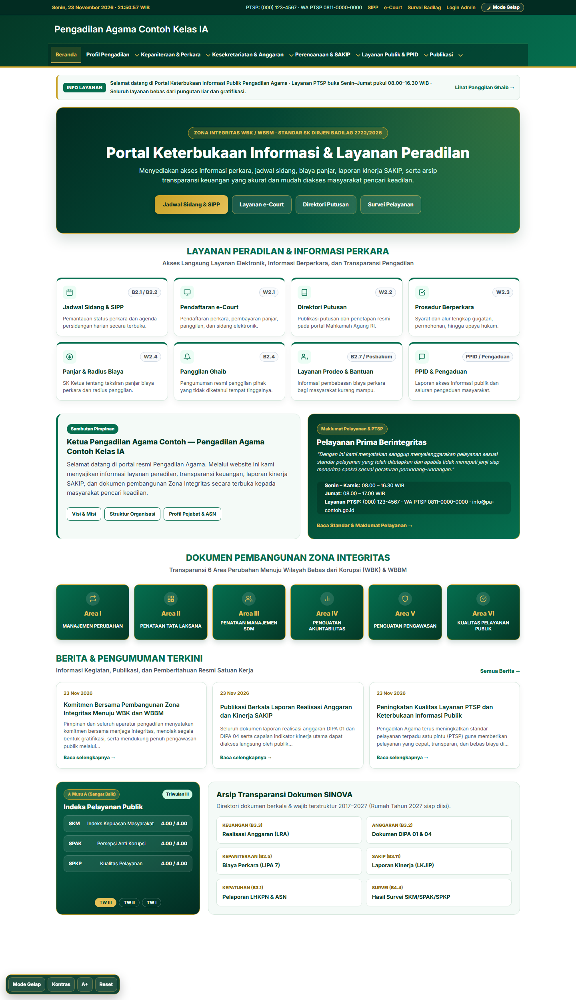

# Starter Kit Website WordPress & Arsip Dokumen SINOVA (SK Dirjen Badilag 2722/2026)

Paket starter **open source** (Lisensi MIT) untuk membantu satuan kerja **Pengadilan Agama** membangun website resmi berbasis WordPress sesuai struktur informasi **SK Dirjen Badilag Nomor 2722/DJA/SK.TI1/X/2026**.

Seluruh fitur dikemas dalam 5 berkas `mu-plugins` tanpa ketergantungan plugin berbayar, serta dapat dipakai **langsung dari WP Admin** maupun dihubungkan ke aplikasi internal satker berbasis Laravel.

---

## Pratinjau Tampilan

### Beranda Portal (Mode Terang)


### Beranda Portal (Mode Gelap / Dark Mode)


### Halaman Arsip Dokumen SINOVA ("Rumah Tahun 2027")


---

## Fitur Utama

1. **Tema Institusional Hijau Gelap & Emas:** Mendukung penuh tema gratis **Astra** (dan tetap berjalan rapi pada tema bawaan WordPress) dengan navigasi dropdown 6 pilar, kotak sambutan pimpinan, layanan perkara, berita terkini, serta footer 4 kolom resmi.
2. **Seeder 1-Klik (40 Halaman & Menu Utama):** Otomatis membuat 23 halaman arsip dokumen SINOVA, 17 halaman informasi wajib bertanda `[LENGKAPI]`, halaman Beranda lengkap, artikel contoh, dan `Menu Utama SINOVA`.
3. **23 Modul Arsip Dokumen SINOVA (Slot s.d. 2027):** Mendukung pengunggahan file **PDF langsung ke server** maupun penautan **Google Drive** berdasarkan tahun, kategori (misal DIPA 01/04, LIPA 7A/7B/7C), bulan, semester, maupun triwulan (SKM/SPAK/SPKP).
4. **Sinkronisasi Otomatis Kartu Survei Beranda:** Setiap unggahan dokumen pada modul `survei-pelayanan` otomatis menautkan tombol SKM, SPAK, dan SPKP di halaman depan ke berkas laporan resminya.
5. **Keamanan & Performa Dasar:** Cache halaman HTML statis, indikator waktu render, pencegahan enumerasi user, XML-RPC nonaktif, filter kata/tautan terlarang (*Anti-Judol WAF*), serta CAPTCHA login ganda (**Cloudflare Turnstile** atau soal hitung offline).

---

## Daftar Isi Folder

```text
sinova-starter-kit/
├── README.md
├── LICENSE
├── .gitignore
├── wordpress-mu-plugins/                  # Wajib disalin ke wp-content/mu-plugins/
│   ├── 00-pa-sinova-config.php            # Pengaturan satker, Seeder 1-Klik, & form upload WP Admin
│   ├── pa-sinova-hub.php                  # Tabel & shortcode [pa_sinova_docs] 23 modul + REST API HMAC
│   ├── pa-home-page-cache.php             # Cache HTML halaman publik & shortcode [waktu_render]
│   ├── pa-ui-performance-a11y.php         # Tampilan portal Astra/blok, berita terkini, & toolbar aksesibilitas
│   └── pa-security-hardening.php          # Header keamanan, filter upload, WAF dasar, & login CAPTCHA
├── wordpress-templates/
│   └── beranda-blocks-starter.html        # Kerangka HTML halaman Beranda standar Pengadilan Agama
├── docs/
│   └── screenshots/                       # Pratinjau tampilan Beranda (Light/Dark) & Modul SINOVA
└── laravel-sinova-panel/                  # Opsional: modul Laravel + Vue jika memakai panel internal kantor
```

---

## Langkah Pemasangan (Berurutan)

### Prasyarat
* WordPress baru terpasang di hosting atau server lokal (PHP 8.1+ dan MySQL/MariaDB).
* Disarankan memasang dan mengaktifkan tema gratis **Astra** melalui **WP Admin → Appearance → Themes → Add New → cari "Astra" → Install & Activate**.

### Langkah 1: Pasang Berkas MU-Plugins
1. Buka direktori instalasi WordPress Anda (misalnya `public_html/wp-content/`).
2. Buat folder baru bernama **`mu-plugins`** jika belum ada.
3. Salin semua berkas `.php` dari folder `wordpress-mu-plugins/` pada repositori ini ke dalam `wp-content/mu-plugins/`.
   *(WordPress otomatis mengaktifkan semua file di `mu-plugins` tanpa perlu menekan tombol Activate.)*

### Langkah 2: Atur Struktur Permalink
1. Masuk ke **WP Admin → Settings (Pengaturan) → Permalinks**.
2. Pilih opsi **Post name** (`/sample-post/`).
3. Klik **Save Changes**.

### Langkah 3: Isi Identitas Satker & Jalankan Seeder 1-Klik
1. Buka menu **WP Admin → SINOVA Hub**.
2. Pada kolom **1. Konfigurasi Satker & REST API HMAC**, lengkapi data berikut lalu klik **Simpan Pengaturan**:
   * **Nama Satker** (misal: `Pengadilan Agama Contoh Kelas I-A`)
   * **Alamat Kantor, Telepon/WA PTSP, & Email Resmi**
   * **Nama & Teks Sambutan Ketua Pengadilan**
   * **URL SIPP, e-Court, Direktori Putusan, & Survei Badilag**
   * *(Opsional)* Centang **Generate Secret Key** bila ingin mengaktifkan sinkronisasi API dengan aplikasi internal kantor.
3. Pada kolom **2. Seeder Halaman & Menu SK 2722/2026**, klik tombol **"Generate Halaman, Beranda & Menu Utama (1-Klik)"**.
   Sistem akan membuat 23 halaman dokumen SINOVA, 17 halaman informasi wajib, halaman Beranda sebagai halaman depan, artikel contoh, dan menyusun `Menu Utama SINOVA` secara otomatis.

### Langkah 4: Unggah Dokumen Rutin (Bulanan / Triwulanan / Tahunan)
Admin satker **tidak perlu** mengedit tabel HTML halaman satu per satu:
1. Buka **WP Admin → SINOVA Hub**.
2. Pada kolom **3. Upload Dokumen Cepat**, pilih:
   * **Modul SINOVA** (contoh: `LRA`, `PNBP`, `Biaya Perkara`, `LKJiP`, atau `Survei Pelayanan`),
   * **Tahun** (tersedia slot hingga tahun `2027`), **Sub-Kelompok**, dan **Periode Slot** (Bulan / Triwulan / Semester / Tahunan),
   * Unggah file **PDF** (maks. 10 MB) atau tempel tautan **Google Drive** yang sudah dibuka akses publiknya (*Anyone with the link*).
3. Klik **Simpan & Tayangkan ke Halaman Web**. Dokumen otomatis tampil pada halaman publik terkait.

### Langkah 5: Lengkapi Halaman Profil & Berita Satker
1. Buka **WP Admin → Pages (Laman)**, lalu sunting halaman bertanda `[LENGKAPI: ...]` (seperti *Visi dan Misi*, *Struktur Organisasi*, *Wilayah Yurisdiksi*, *Alamat & Kontak*, *Standar Pelayanan*, dan *Prosedur Berperkara*).
2. Untuk mengganti tautan Google Drive pada 6 kartu Zona Integritas di Beranda, sunting halaman **Beranda** lalu ubah atribut `href="#ganti-link-area-1"` hingga `area-6` ke folder Google Drive Zona Integritas satker Anda.
3. Publikasikan berita kegiatan atau pengumuman melalui **WP Admin → Posts (Pos) → Add New**; 3 berita terbaru otomatis muncul pada halaman Beranda.

---

## Opsional: Menghubungkan ke Aplikasi Internal Laravel (Jika Tersedia)

Jika satker memiliki aplikasi manajemen internal berbasis Laravel + Inertia Vue 3 dan ingin mengunggah dokumen tanpa membuka `/wp-admin`:
1. Salin isi folder `laravel-sinova-panel/` ke direktori proyek Laravel Anda (`app/`, `database/migrations/`, `resources/js/Pages/`, dan `routes/`).
2. Jalankan migrasi tabel:
   ```bash
   php artisan migrate
   ```
3. Tambahkan konfigurasi berikut di berkas `.env` Laravel (isi `SINOVA_WP_SECRET_KEY` dengan kunci yang dibuat pada **WP Admin → SINOVA Hub**):
   ```env
   SINOVA_WP_BASE_URL=https://domain-satker-anda.go.id
   SINOVA_WP_SECRET_KEY=isi_secret_key_hmac_minimal_32_karakter
   SINOVA_WP_TIMEOUT=30
   ```
4. Jalankan `npm run build` di Laravel, buka halaman `/update-website`, dan sinkronkan seluruh modul.

---

## Daftar Periksa Sebelum Publikasi Online
- Pastikan domain sudah menggunakan **HTTPS/SSL** yang aktif.
- Aktifkan **Autentikasi Dua Faktor (2FA)** untuk seluruh akun Administrator WordPress.
- Bila menggunakan **Cloudflare Turnstile**, isikan *Site Key* dan *Secret Key* di menu **SINOVA Hub** agar halaman login memakai Turnstile; jika dikosongkan, sistem otomatis memakai verifikasi hitung matematika offline.
- Simpan cadangan (*backup*) berkala untuk database dan folder `wp-content/uploads/`.
