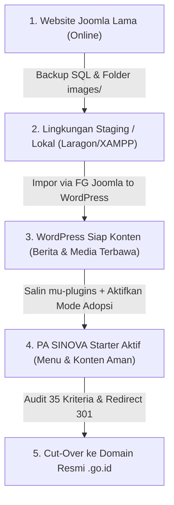

# Panduan Lengkap Migrasi Website Satker dari Joomla ke WordPress + PA SINOVA Starter

> **Standar Rujukan:** SK Dirjen Badilag Mahkamah Agung RI Nomor 2722/DJA/SK.TI1/X/2026  
> **Kompatibilitas:** Joomla 1.5, 2.5, 3.x, 4.x, 5.x → WordPress 6.x + PHP 8.1 / 8.2 / 8.3  
> **Jaminan Keamanan Data:** Non-destruktif (seluruh arsip berita, foto, dan tanggal terbit lama 100% terjaga).

---

## Daftar Isi
1. [Mengapa Migrasi ke WordPress & PA SINOVA Starter?](#1-mengapa-migrasi-ke-wordpress--pa-sinova-starter)
2. [Alur Kerja Migrasi 4 Tahap](#2-alur-kerja-migrasi-4-tahap)
3. [Tahap 1: Persiapan & Pencadangan Data Joomla](#tahap-1-persiapan--pencadangan-data-joomla)
4. [Tahap 2: Impor Konten Menggunakan Plugin FG Joomla to WordPress](#tahap-2-impor-konten-menggunakan-plugin-fg-joomla-to-wordpress)
5. [Tahap 3: Pemasangan Starter Kit & Pengaktifan Mode Adopsi](#tahap-3-pemasangan-starter-kit--pengaktifan-mode-adopsi)
6. [Tahap 4: Penanganan Tautan Lama (Redirect 301 & Permalinks)](#tahap-4-penanganan-tautan-lama-redirect-301--permalinks)
7. [Matriks Troubleshooting & Solusi Error Umum](#7-matriks-troubleshooting--solusi-error-umum)
8. [Daftar Periksa Sebelum Go-Live (Cut-Over)](#8-daftar-periksa-sebelum-go-live-cut-over)

---

## 1. Mengapa Migrasi ke WordPress & PA SINOVA Starter?

Banyak website satuan kerja Pengadilan Agama yang awalnya dibangun di atas CMS Joomla (khususnya versi 3.x yang telah mencapai status *End-of-Life*). Beralih ke WordPress dengan **PA SINOVA Starter** memberikan manfaat besar:

* **Kepatuhan Regulasi SK 2722/2026 & SINOVA:** Pengelolaan 23 modul dokumen publik terstruktur, 6 menu standar, kepatuhan WCAG 2.2, dan fitur pencarian `Ctrl+K`.
* **Ekosistem Terawat & Keamanan Tinggi:** Dukungan PHP 8.2/8.3, WAF bawaan, MFA TOTP RFC 6238, dan penghapusan risiko kerentanan Joomla lawas.
* **Arsip Historis Terjaga:** Seluruh riwayat berita sejak tahun-tahun awal berdirinya website satker tetap dapat dicari dan dibaca oleh masyarakat.

---

## 2. Alur Kerja Migrasi 4 Tahap



> [!IMPORTANT]
> **ATURAN EMAS:** Jangan pernah melakukan migrasi langsung pada server produksi yang sedang live! Selalu siapkan instalasi WordPress bersih di server lokal (*Laragon/XAMPP*) atau subdomain *staging* (misal: `dev.pa-satker.go.id`).

---

## Tahap 1: Persiapan & Pencadangan Data Joomla

Sebelum memulai proses konversi, kumpulkan data dan lakukan backup:

### 1.1. Ekspor Database Joomla
1. Buka **cPanel / phpMyAdmin** pada server hosting Joomla Anda.
2. Pilih database Joomla satker Anda, klik tab **Export** → pilih metode **Quick** → format **SQL** → klik **Go**.
3. Simpan berkas `.sql` ini di komputer Anda dengan aman.

### 1.2. Unduh Folder Media/Gambar
1. Melalui cPanel File Manager atau FTP (FileZilla), unduh seluruh folder `images/` dari direktori root Joomla.
2. Folder ini berisi seluruh foto berita, banner, dan berkas lampiran yang pernah diunggah operator.

### 1.3. Catat Kredensial Database dari `configuration.php`
Buka berkas `configuration.php` pada direktori utama Joomla Anda, dan catat baris-baris berikut:
```php
public $host = 'localhost';
public $user = 'user_joomla';
public $password = 'password_rahasia';
public $db = 'nama_db_joomla';
public $dbprefix = 'jos_'; // Catat prefix tabel ini (bisa jos_, j3_, dsb.)
```

---

## Tahap 2: Impor Konten Menggunakan Plugin FG Joomla to WordPress

Tool resmi dan paling stabil yang direkomendasikan adalah plugin **FG Joomla to WordPress** buatan Frédéric GILLES (telah teruji pada jutaan situs).

### 2.1. Pasang Plugin pada WordPress Baru
1. Masuk ke **WP Admin** WordPress baru Anda.
2. Buka menu **Plugins → Add New** (Tambah Baru).
3. Pada kolom pencarian, ketik: `FG Joomla to WordPress`.
4. Klik **Install Now**, lalu klik **Activate**.

### 2.2. Opsi Penanganan Koneksi Database Joomla
Pilih salah satu metode berikut:

* **Opsi A (Paling Direkomendasikan - Bebas Blokir Firewall):**
  Impor berkas `.sql` Joomla hasil backup tadi ke database lokal yang sama atau database baru di phpMyAdmin lokal WordPress Anda (misal diberi nama `db_joomla_temp`). Dengan cara ini, host database cukup diisi `localhost` tanpa kendala remote port.
* **Opsi B (Koneksi Remote Langsung):**
  Jika server Joomla mengizinkan remote MySQL, pastikan IP server WordPress Anda sudah dimasukkan ke whitelist menu *Remote MySQL* di cPanel hosting Joomla.

### 2.3. Konfigurasi Parameter Impor
Buka menu **Tools → Import → Joomla (FG)** di WP Admin, lalu isi data berikut:

1. **Joomla website URL:** Masukkan alamat URL website Joomla lama (misal: `https://pa-satker.go.id` atau `http://localhost/joomla`).
2. **Database connection:**
   * **Hostname:** `localhost` (bila pakai Opsi A) atau IP server Joomla (bila pakai Opsi B).
   * **Port:** `3306` (standar MySQL).
   * **Database:** Nama database Joomla (misal: `db_joomla_temp`).
   * **User:** User MySQL.
   * **Password:** Password user MySQL.
   * **Joomla table prefix:** Prefix yang dicatat dari `configuration.php` (misal: `jos_` atau `k7x8_`).
3. Klik tombol **"Test the database connection"** (Uji koneksi database).
   * Pastikan muncul notifikasi hijau: *"Connection successful to the Joomla database"*.

### 2.4. Atur Parameter Perilaku Impor (*Behavior*)
Gulir ke bawah pada bagian **Behavior**:
* **Import into WordPress:**
  * Centang **Posts** (Berita) dan **Categories** (Kategori).
  * *Tips:* Untuk **Pages**, jika Anda ingin memakai halaman profil dan layanan resmi bawaan SINOVA SK 2722/2026, Anda boleh **tidak mencentang Pages** agar halaman statis lama tidak menumpuk. Namun jika ada halaman khusus yang ingin disimpan, centang Pages.
* **Media:**
  * Centang **Import images** (Impor gambar).
  * Centang **Keep original upload dates** (Pertahankan tanggal terbit asli).
  * Pilih ukuran thumbnail default.
* **Time out limit:** Ubah ke `120` atau `300` detik bila server Anda memiliki spesifikasi standar.

### 2.5. Eksekusi Impor
1. Klik tombol biru: **"Import content from Joomla to WordPress"**.
2. Biarkan proses berjalan hingga progress bar mencapai **100%**.
3. Setelah selesai, klik tombol **"Modify internal links"** untuk menyesuaikan tautan antar artikel yang tadinya memakai format Joomla agar otomatis diarahkan ke URL WordPress baru.
4. **Verifikasi Konten:** Buka menu **Posts → All Posts** di WP Admin. Pastikan judul berita, kategori, tanggal terbit, dan gambar sampul sudah muncul dengan rapi.
5. **Bersihkan Plugin:** Buka menu **Plugins**, nonaktifkan (*Deactivate*) dan hapus plugin *FG Joomla to WordPress* agar tidak membebani sistem.

---

## Tahap 3: Pemasangan Starter Kit & Pengaktifan Mode Adopsi

Setelah konten Joomla berhasil menjadi postingan WordPress, saatnya menerapkan **PA SINOVA Starter Kit**.

### 3.1. Atur Struktur Permalink WordPress (Wajib)
1. Buka menu **Settings → Permalinks** (Pengaturan → Permalink).
2. Pilih opsi **Post name** (`/%postname%/`).
3. Klik **Save Changes**. Hal ini memastikan URL berita ramah mesin pencari (SEO) dan sesuai standar SINOVA.

### 3.2. Salin Berkas Starter Kit
Salin seluruh 6 berkas PHP dan folder `assets/` dari paket starter kit:
```text
wordpress-mu-plugins/
├── 00-pa-sinova-config.php
├── pa-sinova-hub.php
├── pa-official-feeds-and-data.php
├── pa-home-page-cache.php
├── pa-security-hardening.php
├── pa-ui-performance-a11y.php
└── assets/                     <-- JANGAN LUPA SALIN FOLDER ASSETS INI
```
Tempelkan (*paste*) ke direktori:
```text
wp-content/mu-plugins/
```
*(Jika folder `mu-plugins` belum ada di dalam `wp-content/`, buat folder baru dengan nama tersebut).*

---

### 3.3. ⚠️ Langkah Kunci: Aktifkan "Mode Adopsi Situs Lama"

> [!CAUTION]
> **JANGAN LANGSUNG MENJALANKAN SEEDER STANDAR TANPA MODE ADOPSI!**  
> Menjalankan seeder standar tanpa mode adopsi akan membuat menu navigasi baru dan berisiko mengganti pengaturan halaman Beranda Anda.

Lakukan langkah pengamanan berikut:

1. Buka **WP Admin → SINOVA Hub**.
2. Klik tab **"Migrasi & Adopsi"** (di samping tab Pengaturan Satker).
3. Beri tanda centang pada opsi:
   ☑ **"Pertahankan header, menu navigasi, dan beranda situs lama (Mode Non-Destruktif)"**
4. Klik tombol **"Simpan Mode & Jalankan Seeder Aman"**.

#### Apa yang Dilakukan Mode Adopsi?
* ✅ **Menu Navigasi Aman:** Menu yang sudah dibuat dari hasil migrasi Joomla tidak akan dihapus atau diganti.
* ✅ **Beranda Tidak Tertimpa:** Halaman depan situs Anda tetap utuh sesuai tema WordPress yang Anda pilih (misal: Astra / Hello Elementor).
* ✅ **CSP Otomatis Kompatibel (`compat`):** Mencegah stylesheet atau script bawaan tema lama terblokir oleh pengamanan ketat browser.
* ✅ **Menambahkan Modul SINOVA Bersih:** Sistem hanya akan melengkapi 23 modul dokumen (LRA, DIPA, Renstra, dll.) dan halaman wajib yang belum ada tanpa menyentuh postingan berita lama.

---

### 3.4. Memindahkan Tautan Dokumen Lama ke Modul SINOVA
Jika di artikel-artikel Joomla lama terdapat tautan PDF atau Google Drive (misal dokumen LRA atau DIPA tahun 2021-2025):
1. Masuk ke **WP Admin → SINOVA Hub → tab Migrasi & Adopsi**.
2. Pada bagian **"Ekstrak & Impor Tautan Dokumen"**, pilih halaman/artikel lama.
3. Klik **Pindai Tautan**. Sistem otomatis mendeteksi URL PDF/Drive beserta perkiraan tahun dokumen.
4. Tentukan modul target (misal: `lra`, `dipa`, atau `renstra`) lalu klik **Impor Terpilih**. Seluruh arsip lama Anda kini tersusun rapi dalam tabel publik terstandarisasi Badilag!

---

## Tahap 4: Penanganan Tautan Lama (Redirect 301 & Permalinks)

Joomla umumnya menggunakan pola URL seperti:
* `https://pa-satker.go.id/index.php/berita/123-judul-berita`
* `https://pa-satker.go.id/index.php?option=com_content&view=article&id=123`

Sedangkan WordPress menggunakan:
* `https://pa-satker.go.id/judul-berita/`

Agar pengunjung dari Google atau media sosial tidak menemui pesan error **404 Not Found**, pasang pengalihan otomatis (*301 Permanent Redirect*):

### Cara Praktis dengan Plugin Redirection:
1. Pasang plugin gratis **Redirection** dari menu *Plugins → Add New*.
2. Aktifkan plugin, lalu buka **Tools → Redirection**.
3. Tambahkan aturan regex sederhana untuk menangkap awalan `/index.php/`:
   * **Source URL:** `^/index.php/(.*)$`
   * **Target URL:** `/$1`
   * **Regex:** Centang kotak *Regex*.
4. Klik **Add Redirect**. Seluruh tautan lama otomatis terhubung mulus ke artikel WordPress baru.

---

## 7. Matriks Troubleshooting & Solusi Error Umum

Berikut daftar kendala yang paling sering dikeluhkan operator satker saat migrasi Joomla ke WordPress, beserta solusi teknisnya:

| No | Gejala / Pesan Error | Kemungkinan Penyebab | Langkah Solusi Konkret |
|---|---|---|---|
| **1** | *"Could not connect to the Joomla database"* atau *"Access denied for user"* | Port MySQL remote (`3306`) ditutup oleh firewall hosting, atau password/user database salah. | **Solusi Terbaik:** Jangan gunakan koneksi remote. Ekspor database Joomla ke file `.sql`, lalu impor file tersebut ke database MySQL lokal yang sama dengan WordPress. Gunakan host `localhost` di FG Joomla. |
| **2** | *"Fatal error: Maximum execution time of 30 seconds exceeded"* atau *"504 Gateway Timeout"* | Jumlah artikel dan foto Joomla sangat banyak sehingga batas waktu PHP habis sebelum selesai. | 1. Buka `php.ini` atau file `.htaccess` WordPress, naikkan limit: <br>`max_execution_time = 300`<br>`memory_limit = 512M`<br>2. Buka kembali FG Joomla, klik tombol **"Resume import"** (proses akan lanjut dari titik terakhir tanpa mengulang dari awal). |
| **3** | Foto dan Gambar Berita Tidak Muncul (*Broken Images*) / Tanda Silang Merah | 1. Opsi *Import media* tidak dicentang.<br>2. Server Joomla memblokir hotlink/unduhan dari luar.<br>3. Masalah sertifikat SSL pada URL asal. | 1. Salin folder `images/` dari Joomla secara manual via FTP ke `wp-content/uploads/imported-joomla/`.<br>2. Pada FG Joomla, aktifkan opsi *Import external media* atau gunakan plugin *Velvet Blues Update URLs* untuk menyesuaikan path gambar. |
| **4** | Tulisan Arab / Karakter Spesial Berubah Jadi Tanda Tanya (`???`) atau Aneh | Mismatch encoding database antara Joomla lama (biasanya `latin1_swedish_ci`) dengan WordPress (`utf8mb4`). | Buka berkas SQL dump Joomla sebelum diimpor, pastikan header ekspor menggunakan set karakter UTF-8: `SET NAMES utf8mb4;`. |
| **5** | Layar Putih Polos (*White Screen of Death*) atau Error 500 Setelah Pasang Starter Kit | 1. Versi PHP hosting masih di bawah 8.1 (misal masih PHP 7.4).<br>2. Folder `assets/` tidak ikut disalin ke `wp-content/mu-plugins/`. | 1. Masuk ke cPanel hosting → pilih **Select PHP Version** → ubah ke **PHP 8.2** atau **PHP 8.3**.<br>2. Pastikan file `wp-content/mu-plugins/assets/cctv-aco.gif` dan aset pendukung lainnya berada di posisinya. |
| **6** | Menu Website Hilang atau Beranda Berubah Jadi Kosong Setelah Klik Seeder | Operator lupa mencentang **Mode Adopsi** sebelum menjalankan Seeder. | 1. Buka **Appearance → Menus**, pilih menu utama lama Anda, lalu centang lokasi *Primary Menu* dan simpan.<br>2. Buka **Settings → Reading**, pastikan *Your homepage displays* mengarah ke halaman Beranda Anda.<br>3. Buka **SINOVA Hub → Migrasi & Adopsi**, pastikan Mode Adopsi kini sudah **dicentang**. |

---

## 8. Daftar Periksa Sebelum Go-Live (Cut-Over)

Lakukan verifikasi 5 menit sebelum memindahkan domain resmi ke WordPress baru:

- [ ] Seluruh artikel berita lama dari tahun ke tahun dapat dibuka dengan isi dan gambar lengkap.
- [ ] Permalink WordPress sudah berformat `/%postname%/`.
- [ ] Mode Adopsi aktif di **WP Admin → SINOVA Hub → tab Migrasi & Adopsi**.
- [ ] Nilai kepatuhan pada **Dashboard 3 Pilar & 35 Kriteria** telah diperiksa (skor target &ge; 90 / Predikat Sangat Baik).
- [ ] URL login admin telah diamankan dan MFA TOTP diaktifkan untuk akun operator.
- [ ] Aturan Redirect 301 aktif untuk mencegah error 404 dari Google.
- [ ] Plugin *FG Joomla to WordPress* telah dinonaktifkan dan dihapus.
- [ ] Sertifikat SSL/HTTPS aktif pada domain resmi `.go.id`.

---
*Dokumen ini merupakan bagian dari repositori open source PA WordPress SINOVA Starter Kit.*
