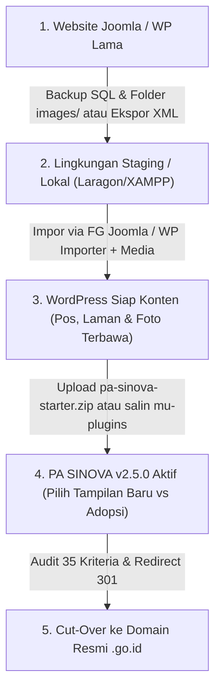

# Panduan Lengkap Migrasi Website Satker dari Joomla ke WordPress + PA SINOVA Starter

> **Standar Rujukan:** SK Dirjen Badilag Mahkamah Agung RI Nomor 2722/DJA/SK.TI1/X/2026  
> **Kompatibilitas:** Joomla 1.5, 2.5, 3.x, 4.x, 5.x → WordPress 6.x + PHP 8.1 / 8.2 / 8.3  
> **Jaminan Keamanan Data:** Non-destruktif (seluruh arsip berita, foto, dan tanggal terbit lama 100% terjaga).

---

## Daftar Isi
1. [Mengapa Migrasi ke WordPress & PA SINOVA Starter?](#1-mengapa-migrasi-ke-wordpress--pa-sinova-starter)
2. [Alur Kerja Migrasi 4 Tahap](#2-alur-kerja-migrasi-4-tahap)
3. [Tahap 1: Persiapan & Pencadangan Data Joomla](#tahap-1-persiapan--pencadangan-data-joomla)
4. [Tahap 2: Impor Konten Menggunakan Plugin FG Joomla to WordPress](#tahap-2-impor-konten-menggunakan-plugin-fg-joomla-to-wordpress)
5. [Tahap 3: Pemasangan Starter Kit & Pengaktifan Mode Adopsi](#tahap-3-pemasangan-starter-kit--pengaktifan-mode-adopsi)
6. [Tahap 4: Penanganan Tautan Lama (Redirect 301 & Permalinks)](#tahap-4-penanganan-tautan-lama-redirect-301--permalinks)
7. [Matriks Troubleshooting & Solusi Error Umum](#7-matriks-troubleshooting--solusi-error-umum)
8. [Daftar Periksa Sebelum Go-Live (Cut-Over)](#8-daftar-periksa-sebelum-go-live-cut-over)

---

## 1. Mengapa Migrasi ke WordPress & PA SINOVA Starter?

Banyak website satuan kerja Pengadilan Agama yang awalnya dibangun di atas CMS Joomla (khususnya versi 3.x yang telah mencapai status *End-of-Life*). Beralih ke WordPress dengan **PA SINOVA Starter** memberikan manfaat besar:

* **Kepatuhan Regulasi SK 2722/2026 & SINOVA:** Pengelolaan 23 modul dokumen publik terstruktur, 6 menu standar, kepatuhan WCAG 2.2, dan fitur pencarian `Ctrl+K`.
* **Ekosistem Terawat & Keamanan Tinggi:** Dukungan PHP 8.2/8.3, WAF bawaan, MFA TOTP RFC 6238, dan penghapusan risiko kerentanan Joomla lawas.
* **Arsip Historis Terjaga:** Seluruh riwayat berita sejak tahun-tahun awal berdirinya website satker tetap dapat dicari dan dibaca oleh masyarakat.

---

## 2. Alur Kerja Migrasi 4 Tahap



> [!IMPORTANT]
> **ATURAN EMAS:** Jangan pernah melakukan migrasi langsung pada server produksi yang sedang live! Selalu siapkan instalasi WordPress bersih di server lokal (*Laragon/XAMPP*) atau subdomain *staging* (misal: `dev.pa-satker.go.id`).

---

## Tahap 1: Persiapan & Pencadangan Data Joomla (Aman untuk Pemula)

> [!NOTE]
> **100% Aman (Hanya Baca & Unduh):** Seluruh langkah di Tahap 1 hanya menyalin/mengunduh data dari website Joomla lama. Website Joomla yang sedang online **tidak akan terganggu, berubah, atau terhapus**.  
> **Penting:** File `.sql` yang akan di-impor adalah **database Joomla milik satker Anda sendiri** (diambil dari hosting/cPanel lama), **bukan** dari paket GitHub PA SINOVA Starter.

### 1.1. Cek Nama Database & Prefix Tabel (`configuration.php`)
Jika di hosting Anda terdapat lebih dari satu database, cek terlebih dahulu nama database yang benar-benar dipakai Joomla:
1. Login ke **cPanel** hosting website Joomla satker Anda → buka **File Manager**.
2. Masuk ke folder utama website (biasanya `public_html/`).
3. Cari berkas bernama **`configuration.php`**, klik kanan → pilih **View** *(jangan Edit agar tidak sengaja mengubah isi)*.
4. Catat 2 baris penting ini:
   ```php
   public $db = 'nama_db_joomla';   // Contoh: pasatker_joomla3
   public $dbprefix = 'jos_';       // Catat prefix tabel ini (misal: jos_, j3_, k7x8_)
   ```

### 1.2. Backup & Download Database Joomla (`.sql`) dari phpMyAdmin Hosting
1. Kembali ke halaman utama **cPanel** → buka menu **phpMyAdmin** (di bagian *Databases*).
2. Di panel sebelah kiri, klik **nama database Joomla** sesuai catatan dari `configuration.php` tadi (pastikan di dalamnya terlihat tabel seperti `jos_content`, `jos_categories`, `jos_users`).
3. Klik tab **Export** di menu bagian atas.
4. Pilih metode ekspor:
   * **Quick** *(cukup untuk sebagian besar satker)* → Format: **SQL** → klik tombol **Go** / **Export**.
   * *(Jika database besar & sering gagal unduh, atau ingin sekalian dikompres)*: pilih **Custom** → pada bagian *Compression* pilih **`zipped`** atau **`gzipped`** → pastikan *Format* tetap **SQL** → gulir ke bawah lalu klik **Go** / **Export**.
5. Tunggu hingga berkas `.sql` (atau `.sql.zip`) selesai terunduh ke folder **Downloads** komputer Anda. Simpan salinannya sebagai backup aman.

### 1.3. Download Folder Foto & Lampiran (`images/`)
1. Kembali ke **cPanel → File Manager → `public_html/`**.
2. Klik kanan folder **`images`** → pilih **Compress** → pilih **Zip Archive** → klik **Compress File(s)**.
3. Setelah muncul berkas `images.zip`, klik kanan berkas tersebut → pilih **Download**.
4. *(Opsional bersih)* Hapus berkas `images.zip` sementara di `public_html/` setelah unduhan di komputer selesai 100%, agar tidak memenuhi kuota hosting. *(Jangan menghapus folder `images` aslinya!)*

### 1.4. Siapkan Database di XAMPP / Laragon Lokal (Untuk Uji Coba Migrasi)
1. Pastikan Anda sudah menginstall **WordPress kosongan** di XAMPP (misal database `db_webpa`) + tema **Astra** + upload plugin **`pa-sinova-starter.zip`**.
2. Buka **phpMyAdmin lokal** (`http://localhost/phpmyadmin/`).
3. Klik **New** di panel kiri → buat **1 database terpisah khusus menampung data Joomla** (misal beri nama `db_joomla_temp`, Collation biarkan `utf8mb4_general_ci`) → klik **Create**.
4. Klik database `db_joomla_temp` di panel kiri → klik tab **Import** → klik **Choose File** → pilih **berkas `.sql` / `.sql.zip` hasil download dari cPanel Joomla di langkah 1.2** → klik **Import / Go** di bagian bawah.
5. Jika berhasil, tabel-tabel Joomla (`jos_content`, dll.) akan muncul di `db_joomla_temp` dan siap ditarik ke WordPress pada **Tahap 2** di bawah.

---

## Tahap 2: Impor Konten Menggunakan Plugin FG Joomla to WordPress

Tool resmi dan paling stabil yang direkomendasikan adalah plugin **FG Joomla to WordPress** buatan Frédéric GILLES (telah teruji pada jutaan situs).

### 2.1. Pasang Plugin pada WordPress Baru
1. Masuk ke **WP Admin** WordPress baru Anda.
2. Buka menu **Plugins → Add New** (Tambah Baru).
3. Pada kolom pencarian, ketik: `FG Joomla to WordPress`.
4. Klik **Install Now**, lalu klik **Activate**.

### 2.2. Opsi Penanganan Koneksi Database Joomla
Pilih salah satu metode berikut:

* **Opsi A (Paling Direkomendasikan - Bebas Blokir Firewall):**
  Impor berkas `.sql` Joomla hasil backup tadi ke database lokal yang sama atau database baru di phpMyAdmin lokal WordPress Anda (misal diberi nama `db_joomla_temp`). Dengan cara ini, host database cukup diisi `localhost` tanpa kendala remote port.
* **Opsi B (Koneksi Remote Langsung):**
  Jika server Joomla mengizinkan remote MySQL, pastikan IP server WordPress Anda sudah dimasukkan ke whitelist menu *Remote MySQL* di cPanel hosting Joomla.

### 2.3. Konfigurasi Parameter Impor
Buka menu **Tools → Import → Joomla (FG)** di WP Admin, lalu isi data berikut:

1. **Joomla website URL:** Masukkan alamat URL website Joomla lama (misal: `https://pa-satker.go.id` atau `http://localhost/joomla`).
2. **Database connection:**
   * **Hostname:** `localhost` (bila pakai Opsi A) atau IP server Joomla (bila pakai Opsi B).
   * **Port:** `3306` (standar MySQL).
   * **Database:** Nama database Joomla (misal: `db_joomla_temp`).
   * **User:** User MySQL.
   * **Password:** Password user MySQL.
   * **Joomla table prefix:** Prefix yang dicatat dari `configuration.php` (misal: `jos_` atau `k7x8_`).
3. Klik tombol **"Test the database connection"** (Uji koneksi database).
   * Pastikan muncul notifikasi hijau: *"Connection successful to the Joomla database"*.

### 2.4. Atur Parameter Perilaku Impor (*Behavior*)
Gulir ke bawah pada bagian **Behavior**:
* **Import into WordPress:**
  * Centang **Posts** (Berita) dan **Categories** (Kategori).
  * *Tips:* Untuk **Pages** (Laman), jika ada halaman statis penting dari Joomla yang ingin dipertahankan, silakan centang **Pages**. Namun bila Anda ingin memakai struktur 23+ laman resmi bawaan SINOVA SK 2722/2026 tanpa duplikasi, Anda dapat membiarkannya tidak tercentang (atau merapikannya setelah impor).
* **Media & Foto Berita:**
  * Centang **Import images** / **Import media** agar seluruh file foto di artikel disalin ke Media Library (`wp-content/uploads/`).
  * Pada opsi **Featured image**, pilih **Intro image** atau **First image of the post** agar setiap berita langsung punya thumbnail *Featured Image* WordPress.
  * Centang **Keep original upload dates** (Pertahankan tanggal terbit asli).
  * *Catatan sinkronisasi otomatis PA SINOVA v2.5.0:* Seandainya ada berita hasil migrasi yang belum memiliki *Featured Image* (hanya berisi `` di isi artikel), fungsi `pa_portal_extract_post_thumb()` otomatis mengambil foto pertama di isi berita tersebut untuk kartu berita Beranda, pengumuman, dan widget portal (termasuk mengubah path relatif `/images/...` melalui `home_url()`).
* **Time out limit:** Ubah ke `120` atau `300` detik bila server Anda memiliki spesifikasi standar.
* *Catatan Firewall:* Filter Anti-Judol PA SINOVA otomatis nonaktif selama proses impor (`WP_IMPORTING`), sehingga impor ribuan berita/halaman lama tidak akan terblokir *false-positive*.

### 2.5. Eksekusi Impor
1. Klik tombol biru: **"Import content from Joomla to WordPress"**.
2. Biarkan proses berjalan hingga progress bar mencapai **100%**.
3. Setelah selesai, klik tombol **"Modify internal links"** untuk menyesuaikan tautan antar artikel yang tadinya memakai format Joomla agar otomatis diarahkan ke URL WordPress baru.
4. **Verifikasi Konten:** Buka menu **Posts → All Posts** di WP Admin. Pastikan judul berita, kategori, tanggal terbit, dan gambar sampul sudah muncul dengan rapi.
5. **Bersihkan Plugin:** Buka menu **Plugins**, nonaktifkan (*Deactivate*) dan hapus plugin *FG Joomla to WordPress* agar tidak membebani sistem.

---

## Tahap 3: Pemasangan Starter Kit & Pengaktifan Mode Adopsi

Setelah konten Joomla berhasil menjadi postingan WordPress, saatnya menerapkan **PA SINOVA Starter Kit**.

### 3.1. Atur Struktur Permalink WordPress (Wajib)
1. Buka menu **Settings → Permalinks** (Pengaturan → Permalink).
2. Pilih opsi **Post name** (`/%postname%/`).
3. Klik **Save Changes**. Hal ini memastikan URL berita ramah mesin pencari (SEO) dan sesuai standar SINOVA.

### 3.2. Pasang PA SINOVA Starter Kit v2.5.0
Pilih **salah satu** metode pemasangan berikut:

* **Metode A — Upload ZIP 1-Klik (Disarankan):**
  1. Buka **WP Admin → Plugins → Add New Plugin → Upload Plugin**.
  2. Pilih berkas `dist/pa-sinova-starter.zip`, lalu klik **Install Now → Activate Plugin**.
  3. Seluruh 6 modul inti PHP, `assets/cctv-aco.gif`, dan 5 gambar dummy SVG otomatis terpasang sekaligus mendukung pembaruan 1-klik dari GitHub.
* **Metode B — Salin Manual ke `wp-content/mu-plugins/`:**
  Salin seluruh 6 berkas PHP dan folder `assets/` dari folder `wordpress-mu-plugins/` paket rilis:
  ```text
  wp-content/mu-plugins/
  ├── 00-pa-sinova-config.php
  ├── pa-sinova-hub.php
  ├── pa-official-feeds-and-data.php
  ├── pa-home-page-cache.php
  ├── pa-security-hardening.php
  ├── pa-ui-performance-a11y.php
  └── assets/                     <-- JANGAN LUPA (isi: cctv-aco.gif + dummy-*.svg)
  ```

---

### 3.3. ⚠️ Pilih Mode Setelah Aktivasi (Tampilan Baru v2.5.0 vs Adopsi Situs Lama)

Saat Anda mengaktifkan `pa-sinova-starter.zip` pada WordPress yang sudah berisi konten (> 2 postingan berita, > 3 laman, atau terdeteksi Elementor/Divi/WPBakery), sistem otomatis menyalakan **Mode Adopsi Situs Lama** (`preserve_existing_design` + CSP `compat`) demi keamanan agar menu dan beranda eksisting tidak tertimpa mendadak.

Pilih skenario yang sesuai dengan kondisi satker Anda:

#### Skenario A — Dari Joomla (atau WP Baru) dan Ingin Memakai Tampilan Modern PA SINOVA v2.5.0
Berita dan halaman yang sudah diimpor **tetap aman** dan **tidak dihapus** oleh seeder SINOVA.
1. Buka **WP Admin → SINOVA Hub → tab Migrasi & Adopsi**.
2. **Hapus tanda centang** pada *"Pertahankan header, menu navigasi, dan beranda situs lama (Mode Non-Destruktif)"*, lalu simpan.
3. Jalankan **Generate Halaman, Beranda & Menu (1-Klik)**.
4. Hasilnya:
   * ✅ Seluruh postingan berita & foto hasil migrasi Joomla tetap utuh dan otomatis tampil di grid Berita Terkini & Pengumuman Beranda.
   * ✅ Halaman statis lama yang sudah ada tetap tersimpan di **Pages** (sistem hanya membuat halaman wajib SINOVA/KMA 2-144/2022 yang belum ada).
   * ✅ Beranda modern 12-kolom + 6 Menu Utama Standar SK 2722/2026 langsung aktif.

#### Skenario B — Website WordPress Lama (Elementor / Tema Eksisting) yang Tetap Mempertahankan Desain & Menu Lama
1. Pastikan di **WP Admin → SINOVA Hub → tab Migrasi & Adopsi**, opsi:
   ☑ **"Pertahankan header, menu navigasi, dan beranda situs lama (Mode Non-Destruktif)"** tetap **tercentang**.
2. Klik tombol **"Simpan Mode & Jalankan Seeder Aman"**.
3. Hasilnya:
   * ✅ **Menu Navigasi Aman:** Menu utama dan header situs lama tidak akan dihapus atau diganti.
   * ✅ **Beranda Tidak Tertimpa:** Halaman depan Elementor / Astra / tema lama Anda tetap utuh.
   * ✅ **CSP Otomatis Kompatibel (`compat`):** Mencegah stylesheet atau script tema lama terblokir browser.
   * ✅ **Modul SINOVA Terpasang Rapi:** Sistem hanya menambahkan 23+ laman arsip dokumen (LRA, DIPA, Renstra, dll.) yang belum ada tanpa menyentuh postingan berita maupun halaman lama.

---

### 3.4. Memindahkan Tautan Dokumen Lama ke Modul SINOVA
Jika di artikel-artikel Joomla lama terdapat tautan PDF atau Google Drive (misal dokumen LRA atau DIPA tahun 2021-2025):
1. Masuk ke **WP Admin → SINOVA Hub → tab Migrasi & Adopsi**.
2. Pada bagian **"Ekstrak & Impor Tautan Dokumen"**, pilih halaman/artikel lama.
3. Klik **Pindai Tautan**. Sistem otomatis mendeteksi URL PDF/Drive beserta perkiraan tahun dokumen.
4. Tentukan modul target (misal: `lra`, `dipa`, atau `renstra`) lalu klik **Impor Terpilih**. Seluruh arsip lama Anda kini tersusun rapi dalam tabel publik terstandarisasi Badilag!

---

## Tahap 4: Penanganan Tautan Lama (Redirect 301 & Permalinks)

Joomla umumnya menggunakan pola URL seperti:
* `https://pa-satker.go.id/index.php/berita/123-judul-berita`
* `https://pa-satker.go.id/index.php?option=com_content&view=article&id=123`

Sedangkan WordPress menggunakan:
* `https://pa-satker.go.id/judul-berita/`

Agar pengunjung dari Google atau media sosial tidak menemui pesan error **404 Not Found**, pasang pengalihan otomatis (*301 Permanent Redirect*):

### Cara Praktis dengan Plugin Redirection:
1. Pasang plugin gratis **Redirection** dari menu *Plugins → Add New*.
2. Aktifkan plugin, lalu buka **Tools → Redirection**.
3. Tambahkan aturan regex sederhana untuk menangkap awalan `/index.php/`:
   * **Source URL:** `^/index.php/(.*)$`
   * **Target URL:** `/$1`
   * **Regex:** Centang kotak *Regex*.
4. Klik **Add Redirect**. Seluruh tautan lama otomatis terhubung mulus ke artikel WordPress baru.

---

## Tahap 5: Migrasi dari Website WordPress Lama ke PA SINOVA v2.5.0

Jika satker saat ini **sudah menggunakan WordPress**, terdapat dua jalur yang sama-sama menjaga seluruh **berita (Posts), laman (Pages), dan foto (Media Library)**:

### Jalur 1 — Pasang Langsung di Website WordPress Saat Ini (*In-Place*)
1. Backup penuh database & `wp-content/uploads/` sebelum memulai.
2. Upload dan aktifkan `dist/pa-sinova-starter.zip` melalui **Plugins → Add New Plugin → Upload Plugin**.
3. Karena sistem mendeteksi postingan/laman lama Anda, **Mode Adopsi Situs Lama** aktif otomatis agar menu dan beranda lama tidak berubah mendadak:
   * Jika ingin mempertahankan desain lama → cukup klik **Simpan Mode & Jalankan Seeder Aman** di tab **Migrasi & Adopsi**.
   * Jika ingin beralih ke tampilan Beranda v2.5.0 + 6 Menu Standar → matikan centang **Mode Adopsi** lalu klik **Generate Halaman, Beranda & Menu (1-Klik)**. Seluruh berita, kategori, laman lama, dan foto Media Library tetap utuh.

### Jalur 2 — Pindah dari WordPress Lama ke Instalasi WordPress Baru (*Fresh Install*)
1. **Di WordPress Lama:** Buka **Tools → Export → All content** (atau ekspor terpisah *Posts* dan *Pages*) untuk mengunduh berkas `.xml` (*WXR*). **Pastikan website WordPress lama masih online/dapat diakses** selama proses impor berlangsung agar lampiran foto bisa diunduh otomatis.
2. **Di WordPress Baru:**
   * Buka **Tools → Import → WordPress → Run Importer**.
   * Unggah file `.xml` dari WP lama.
   * **WAJIB centang kotak `"Download and import file attachments"`** pada halaman *Assign Authors* sebelum klik **Submit**, agar seluruh foto berita & gambar di dalam laman disalin masuk ke `wp-content/uploads/` WordPress baru.
   * *(Alternatif bila situs WP lama offline / pakai banyak Custom Post Type & Elementor)*: gunakan plugin kloning utuh seperti **All-in-One WP Migration** atau **UpdraftPlus** agar database dan seluruh folder `uploads/` pindah 100% identik, baru kemudian aktifkan `pa-sinova-starter.zip`.
3. Pasang `pa-sinova-starter.zip`, sesuaikan **Settings → Permalinks (`/%postname%/`)**, lalu pilih **Skenario A** atau **Skenario B** pada **Tahap 3.3** di atas.
4. Untuk berita lama yang *Featured Image*-nya tidak ikut terset (hanya berupa gambar di dalam badan artikel), modul Beranda PA SINOVA otomatis menampilkan gambar pertama artikel via `pa_portal_extract_post_thumb()`.

---

## 7. Matriks Troubleshooting & Solusi Error Umum

Berikut daftar kendala yang paling sering dikeluhkan operator satker saat migrasi Joomla ke WordPress, beserta solusi teknisnya:

| No | Gejala / Pesan Error | Kemungkinan Penyebab | Langkah Solusi Konkret |
|---|---|---|---|
| **1** | *"Could not connect to the Joomla database"* atau *"Access denied for user"* | Port MySQL remote (`3306`) ditutup oleh firewall hosting, atau password/user database salah. | **Solusi Terbaik:** Jangan gunakan koneksi remote. Ekspor database Joomla ke file `.sql`, lalu impor file tersebut ke database MySQL lokal yang sama dengan WordPress. Gunakan host `localhost` di FG Joomla. |
| **2** | *"Fatal error: Maximum execution time of 30 seconds exceeded"* atau *"504 Gateway Timeout"* | Jumlah artikel dan foto Joomla sangat banyak sehingga batas waktu PHP habis sebelum selesai. | 1. Buka `php.ini` atau file `.htaccess` WordPress, naikkan limit: <br>`max_execution_time = 300`<br>`memory_limit = 512M`<br>2. Buka kembali FG Joomla, klik tombol **"Resume import"** (proses akan lanjut dari titik terakhir tanpa mengulang dari awal). |
| **3** | Foto dan Gambar Berita Tidak Muncul (*Broken Images*) / Tanda Silang Merah | 1. Opsi *Import media* tidak dicentang.<br>2. Server Joomla memblokir hotlink/unduhan dari luar.<br>3. Masalah sertifikat SSL pada URL asal. | 1. Salin folder `images/` dari Joomla secara manual via FTP ke `wp-content/uploads/imported-joomla/`.<br>2. Pada FG Joomla, aktifkan opsi *Import external media* atau gunakan plugin *Velvet Blues Update URLs* untuk menyesuaikan path gambar. |
| **4** | Tulisan Arab / Karakter Spesial Berubah Jadi Tanda Tanya (`???`) atau Aneh | Mismatch encoding database antara Joomla lama (biasanya `latin1_swedish_ci`) dengan WordPress (`utf8mb4`). | Buka berkas SQL dump Joomla sebelum diimpor, pastikan header ekspor menggunakan set karakter UTF-8: `SET NAMES utf8mb4;`. |
| **5** | Layar Putih Polos (*White Screen of Death*) atau Error 500 Setelah Pasang Starter Kit | 1. Versi PHP hosting masih di bawah 8.1 (misal masih PHP 7.4).<br>2. Folder `assets/` tidak ikut disalin ke `wp-content/mu-plugins/`. | 1. Masuk ke cPanel hosting → pilih **Select PHP Version** → ubah ke **PHP 8.2** atau **PHP 8.3**.<br>2. Pastikan file `wp-content/mu-plugins/assets/cctv-aco.gif` dan aset pendukung lainnya berada di posisinya. |
| **6** | Menu Website Hilang atau Beranda Berubah Jadi Kosong Setelah Klik Seeder | Operator lupa mencentang **Mode Adopsi** sebelum menjalankan Seeder. | 1. Buka **Appearance → Menus**, pilih menu utama lama Anda, lalu centang lokasi *Primary Menu* dan simpan.<br>2. Buka **Settings → Reading**, pastikan *Your homepage displays* mengarah ke halaman Beranda Anda.<br>3. Buka **SINOVA Hub → Migrasi & Adopsi**, pastikan Mode Adopsi kini sudah **dicentang**. |

---

## 8. Daftar Periksa Sebelum Go-Live (Cut-Over)

Lakukan verifikasi 5 menit sebelum memindahkan domain resmi ke WordPress baru:

- [ ] Seluruh artikel berita dan laman penting lama dapat dibuka dengan isi dan foto lengkap (termasuk gambar di Media Library).
- [ ] Permalink WordPress sudah berformat `/%postname%/`.
- [ ] Mode tampilan telah dipastikan di **WP Admin → SINOVA Hub → tab Migrasi & Adopsi** (Mode Adopsi ON jika pakai tema/menu lama, atau OFF + Seeder 1-Klik jika memakai Beranda modern v2.5.0).
- [ ] Nilai kepatuhan pada **Dashboard 3 Pilar & 35 Kriteria** telah diperiksa (skor target &ge; 90 / Predikat Sangat Baik).
- [ ] URL login admin telah diamankan dan MFA TOTP diaktifkan untuk akun operator.
- [ ] Aturan Redirect 301 aktif untuk mencegah error 404 dari Google (khususnya URL `/index.php/...` dari Joomla).
- [ ] Plugin *FG Joomla to WordPress* (jika dari Joomla) telah dinonaktifkan dan dihapus.
- [ ] Sertifikat SSL/HTTPS aktif pada domain resmi `.go.id`.

---
*Dokumen ini merupakan bagian dari repositori open source PA WordPress SINOVA Starter Kit.*
